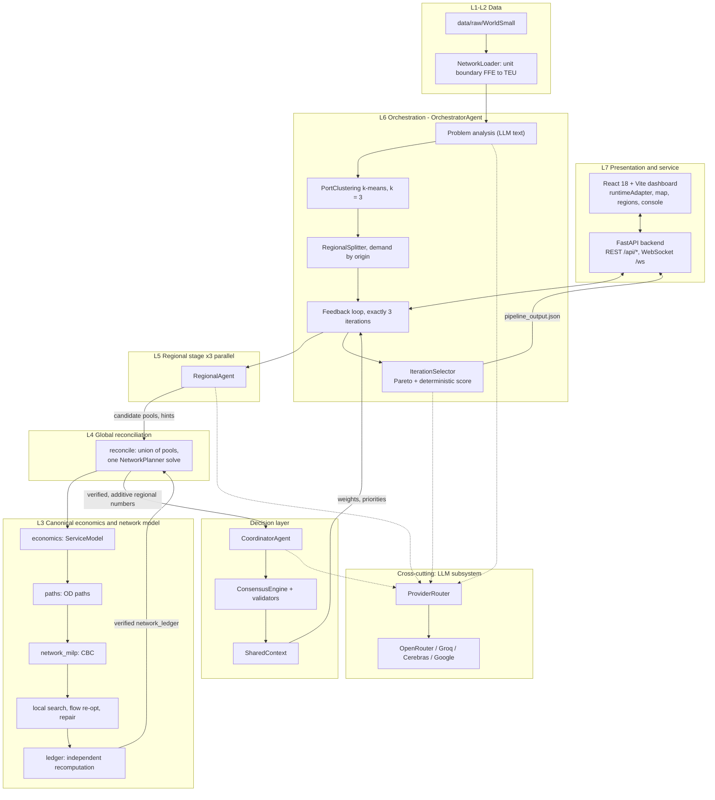
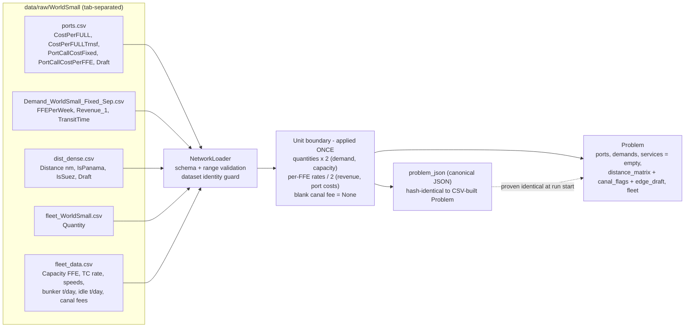
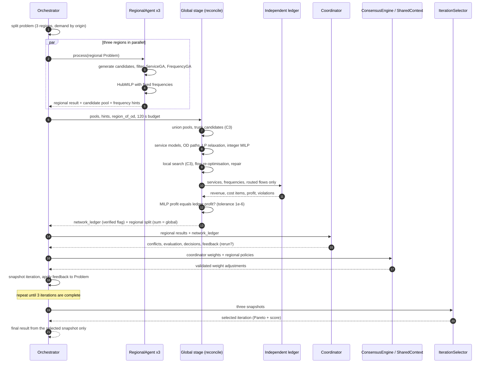
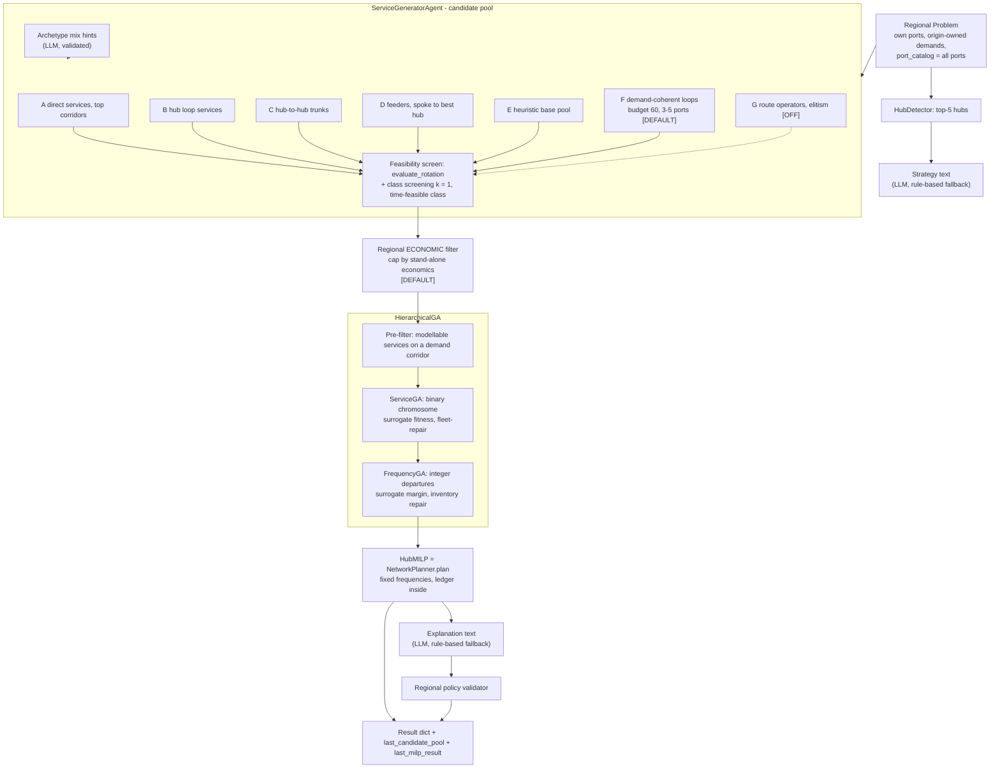
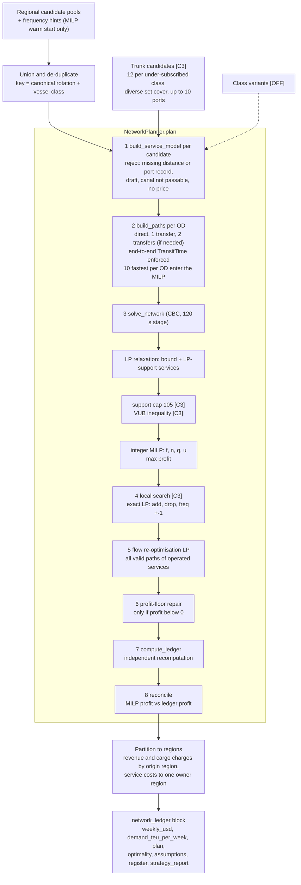
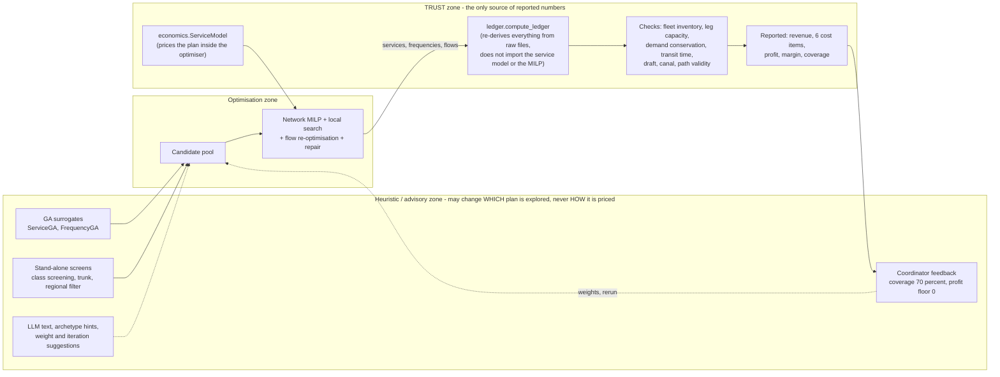
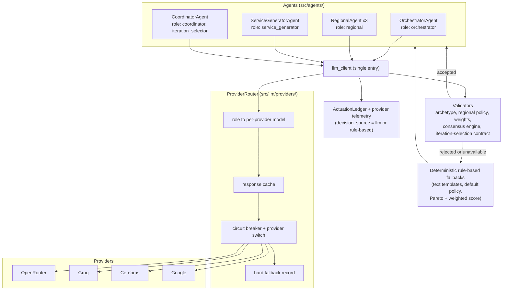
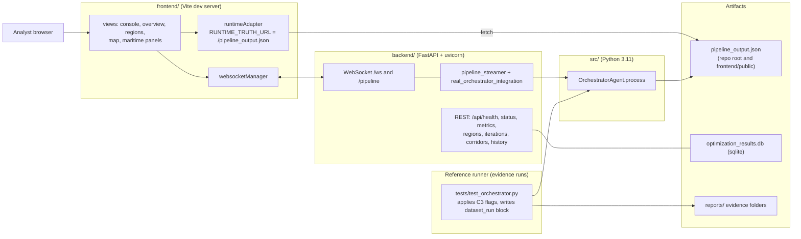

# System Architecture - Block Diagrams of the Present Working Configuration

AI Vessel Routing System (hierarchical multi-agent GA + MILP liner-shipping network design)

| Item | Value |
|---|---|
| Written | 2026-10-17 |
| Code state | git `HEAD` `47bbdb9` + uncommitted working tree (see `COST_REVENUE_PROFIT_FORMULATION.md`, header) |
| Companion document | `docs/COST_REVENUE_PROFIT_FORMULATION.md` (all cost / revenue / profit formulas and assumptions) |
| Basis | Every box below was traced to a source file that was read (Section 11 lists them). Where a box exists in the code but is switched off in this configuration it is drawn dashed / marked `[OFF]`. |
| Figures | Fig. 1 is plain ASCII (renders anywhere, copy-paste safe). Figs. 2-9 are Mermaid (render on GitHub/GitLab, VS Code Markdown preview, Obsidian, mermaid.live). |

**Reading key.** `[C3]` = switched on by the C3 flag set; `[DEFAULT]` = on in the code defaults; `[OFF]` = present in code, off in this configuration; `[LLM]` = a step that calls a language model and has a deterministic fallback; `{TRUST}` = a boundary that defines which numbers may be reported.

---

## 0. One-paragraph description

Five tab-separated LINERLIB files are loaded once, with the FFE -> TEU unit conversion applied at the loader boundary, into a single `Problem`. An **Orchestrator** clusters the ports (k-means, 3 clusters for 47 ports), splits the demand by origin into three disjoint regional problems and runs a bounded feedback loop of exactly three iterations. In each iteration three **Regional Agents** run in parallel threads: they generate a pool of candidate service rotations, filter it, select services and frequencies with a two-level genetic algorithm that uses a *surrogate* economy, and allocate cargo with a MILP. Their results are then **discarded as economic truth**: a **global reconciliation stage** unites all regional candidate pools and solves **one** network design MILP (services, integer weekly frequencies, vessels, cargo flows) over the whole demand, improves it by exact-LP local search, flow re-optimisation and (if needed) profit-floor repair, and hands the plan to an **independent ledger** that recomputes revenue, every cost item and every constraint from the raw data alone. Only ledger-verified figures are reported. A **Coordinator** turns the verified numbers into feedback signals, an **Iteration Selector** picks the best of the three iterations (Pareto + deterministic score), and the result is written to `pipeline_output.json`, which a FastAPI backend and a React dashboard present. Language models are used for narrative text, candidate-mix hints, weight suggestions and iteration choice - always behind validators with rule-based fallbacks - and never inside the ledger.

---

## Fig. 1 - Master block diagram (ASCII)

```
+==================================================================================================+
| L7  PRESENTATION / SERVICE                                                                       |
|     React 18 + Vite + Tailwind + d3-geo  (frontend/)                                             |
|        runtimeAdapter normalises /pipeline_output.json and WebSocket events                      |
|             ^  HTTP /api/*  +  WebSocket /ws  (live stage events)                                |
|     FastAPI backend (backend/unified_main.py, routes/, pipeline_streamer, websocket_manager)     |
|        real_orchestrator_integration.py  --> starts the OrchestratorAgent with a stream callback |
+============================================^=====================================================+
                                             | pipeline_output.json (root + frontend/public), sqlite
+============================================|=====================================================+
| L6  ORCHESTRATION (src/agents/orchestrator_agent.py)                                             |
|                                                                                                  |
|   analyze_problem [LLM] -> PortClustering (k-means, k=3 for <50 ports)                           |
|        -> RegionalSplitter (demand by ORIGIN only: disjoint, zero duplication)                   |
|                                                                                                  |
|   FOR iteration = 0,1,2   (MIN = MAX = 3)                                                        |
|     +-----------------------------------------------------------------------------------------+  |
|     | (a) 3 x RegionalAgent in parallel threads  ----------------------> candidate pools, hints |  |
|     | (b) GLOBAL RECONCILIATION  {TRUST}  ----------> verified network_ledger + regional split  |  |
|     | (c) CoordinatorAgent  ---> conflicts, evaluation, decisions, feedback signals            |  |
|     | (d) ConsensusEngine + SharedContext ---> validated weight / policy update                 |  |
|     | (e) iteration snapshot (metrics, services, network_ledger)                                |  |
|     | (f) stop if (iteration+1 >= 3) AND no rerun needed; else apply feedback, next iteration   |  |
|     +-----------------------------------------------------------------------------------------+  |
|   IterationSelector (Pareto dominance + weighted score; LLM proposal validated) -> final result  |
|   executive summary [LLM, rule-based fallback]                                                   |
+==========+=====================================================================+=================+
           |                                                                     |
           v                                                                     v
+---------------------------------------------------+   +--------------------------------------+
| L5  REGIONAL STAGE  (x3, parallel)                |   | L4  GLOBAL RECONCILIATION STAGE      |
|  src/agents/regional_agent.py                     |   |  src/network/reconcile.py            |
|                                                   |   |                                      |
|  HubDetector -> strategy text [LLM]               |   |  union of regional pools             |
|  ServiceGeneratorAgent                            |   |   (dedupe: canonical rotation+class) |
|    A direct  B hub loops  C hub trunks            |   |  + trunk candidates          [C3]    |
|    D feeders E heuristic  F demand-coherent loops |   |  + class variants           [OFF]    |
|    G route operators / elitism [OFF]              |   |            |                         |
|    + per-rotation class screening (k=1)           |   |            v                         |
|  regional ECONOMIC filter (cap, stand-alone econ.)|   |  NetworkPlanner.plan                 |
|  HierarchicalGA                                   |   |   1 build_service_model  (economics) |
|    ServiceGA  (binary chromosome, surrogate)      |   |   2 build_paths  (transit-limited)   |
|    FrequencyGA (integer departures, surrogate)    |   |   3 solve_network (CBC)              |
|  HubMILP = NetworkPlanner with FIXED frequencies  |   |       LP relaxation -> bound         |
|  explanation text [LLM]; regional policy validate |   |       support cap 105 [C3] + VUB [C3]|
|                                                   |   |       integer MILP, 120 s stage      |
|  outputs: last_candidate_pool, last_milp_result   |   |   4 local search (exact LP)  [C3]    |
|           (frequencies used only as a MILP hint)  |   |   5 flow re-optimisation LP          |
|                                                   |   |   6 profit-floor repair (if < 0)     |
|  regional economics are SUPERSEDED by L4          |   |   7 compute_ledger {TRUST}           |
+---------------------------------------------------+   |   8 reconcile MILP vs ledger         |
           |  pools + hints                              |  partition to regions (sum = global) |
           +-------------------------------------------> |  strategy_report                     |
                                                         +------------------+-------------------+
                                                                            |
+===========================================================================|======================+
| L3  CANONICAL ECONOMICS AND NETWORK MODEL (src/network/)                  v                      |
|   economics.py  ServiceModel: T, vessels = ceil(T f / 7), fuel, port-call, hire                  |
|   physical_rules.py  draft + canal rules       bunker_prices.py  600 USD/t uniform [DEFAULT]     |
|   paths.py  OD paths, <= 2 transfers, end-to-end TransitTime enforced                           |
|   network_milp.py  objective = operating profit      flow_reopt.py   local_search.py            |
|   ledger.py  INDEPENDENT recomputation (does not import the service model or the MILP) {TRUST}  |
|   metrics.py  canonical decision-layer economics (revenue, all-in cost, profit, margin band)     |
|   assumption_register.py   solve_semantics.py (what "Optimal" does / does not prove)             |
+==========================================================^=======================================+
                                                           |
+==========================================================|=======================================+
| L2  DATA LAYER                                           |                                       |
|   src/data/network_loader.py   validate + convert once: FFEPerWeek x2, Revenue /2, Capacity x2,  |
|                                per-FFE port costs /2, blank canal fee -> None                    |
|   dataset_registry.py, problem_json.py (canonical JSON proven identical to the CSV-built Problem)|
|   Problem(ports, demands, distance_matrix + canal_flags + edge_draft, fleet, services=[])        |
+==========================================================^=======================================+
                                                           |
+==========================================================|=======================================+
| L1  RAW DATA   data/raw/WorldSmall/ (tab-separated)      |                                       |
|   ports.csv (47)  Demand_WorldSmall_Fixed_Sep.csv (1764 ODs)  dist_dense.csv (2162 directed pairs)|
|   fleet_data.csv (6 classes)  fleet_WorldSmall.csv (263 vessels)                                 |
|   optional [OFF]: data/pricing/bunker_snapshot_*.json    data/maritime/snapshots/                |
+==================================================================================================+

  CROSS-CUTTING
  +--------------------------------------------------------------------------------------------+
  | LLM SUBSYSTEM  src/llm/: llm_client -> ProviderRouter (role -> model, cache, circuit breaker,|
  |   provider switch, hard fallback) -> OpenRouter | Groq | Cerebras | Google; ActuationLedger  |
  | VALIDATION     archetype_validator, regional_policy_validator(_v2), weight_validator,        |
  |   consensus_engine - an LLM suggestion is accepted only after validation, else rule-based    |
  | MARITIME INTELLIGENCE [OFF]  maritime/optimizer_bridge: weather speed factor, port-capacity   |
  |   override (only when MARITIME_INTELLIGENCE_ENABLED=1)                                      |
  | TELEMETRY      health_tracker, shared_context, structured logger, actuation records         |
  +--------------------------------------------------------------------------------------------+
```

---

## Fig. 2 - Layered architecture (Mermaid)



---

## Fig. 3 - Data layer and the unit boundary (Mermaid)



---

## Fig. 4 - One iteration, in time order (Mermaid sequence)



---

## Fig. 5 - Regional agent internals (Mermaid)



---

## Fig. 6 - Global reconciliation stage and network planner (Mermaid)



---

## Fig. 7 - Trust boundaries: what may enter a reported number (Mermaid)



---

## Fig. 8 - Agents, LLM subsystem and fallbacks (Mermaid)



---

## Fig. 9 - Runtime and deployment view (Mermaid)



---

## 10. Component table

| Block | Responsibility | Main source files |
|---|---|---|
| Loader / unit boundary | validate tab-separated sources; FFE -> TEU once; dataset identity guard | `src/data/network_loader.py`, `dataset_registry.py`, `dataset_validation.py`, `problem_json.py` |
| Orchestrator | analysis, clustering, split, 3-iteration loop, feedback, selection, final aggregation | `src/agents/orchestrator_agent.py` |
| Decomposition | k-means port clusters; origin-only demand split | `src/decomposition/port_clustering.py`, `regional_splitter.py` |
| Regional agent | per-region candidate generation, GA, HubMILP | `src/agents/regional_agent.py` |
| Candidate generation | sections A-G, feasibility, class screening, demand-coherent loops | `src/agents/service_generator_agent.py`, `src/services/*` |
| Regional filter | economic cap of the pool | `src/services/regional_filter.py` |
| GA | two-level surrogate search | `src/optimization/hierarchical_ga.py`, `service_ga.py`, `frequency_ga.py`, `normalization.py`, `adaptive_budget.py` |
| Canonical model | service physics and cost, OD paths, MILP, ledger | `src/network/economics.py`, `paths.py`, `network_milp.py`, `ledger.py`, `physical_rules.py`, `bunker_prices.py` |
| Planner | models -> paths -> MILP -> post-solve -> ledger | `src/network/plan.py` |
| Post-solve | local search, flow re-optimisation, repair | `src/network/local_search.py`, `flow_reopt.py` |
| Global stage | union pools, trunk candidates, planner, regional partition | `src/network/reconcile.py`, `trunk_candidates.py`, `class_variants.py` |
| Decision metrics | canonical economics for coordinator/selector; advisory margin band | `src/network/metrics.py` |
| Coordinator | conflicts, evaluation, decisions, feedback | `src/agents/coordinator_agent.py` |
| Consensus / validation | weight and policy validation | `src/validation/*` |
| Iteration selection | scorecards, Pareto, deterministic or validated-LLM choice | `src/pipeline/iteration_selection.py` |
| LLM subsystem | client, router, providers, actuation telemetry | `src/llm/*`, `src/llm/providers/*` |
| Reporting / audit | assumption register, solve semantics, strategy report, paper-comparison ledger | `src/network/assumption_register.py`, `solve_semantics.py`, `strategy_report.py`, `src/benchmark/*` |
| Service + UI | REST, WebSocket, dashboard | `backend/*`, `frontend/src/*` |
| Optional | maritime intelligence (weather, port capacity) | `maritime/*` (default OFF) |

## 11. Controlling parameters visible in the diagrams

| Parameter | Value in this configuration | Where |
|---|---|---|
| Clusters / regional agents used | 3 (`n_clusters = 3 if ports < 50 else 5`); 5 agents are constructed, the first `n_clusters` are used | `orchestrator_agent.py:666-670, 760` |
| Iterations | 3 (`MIN_ITERATIONS = MAX_ITERATIONS = 3`) | `orchestrator_agent.py:33-34` |
| Global stage budget | 120 s (`GLOBAL_STAGE_TIME_LIMIT_SEC`); 15 s of it reserved for local search [C3] | `orchestrator_agent.py:355`, `local_search.py:61` |
| Rerun triggers | coverage < 70 %, profit < 0, any overlap conflict | `coordinator_agent.py` |
| ServiceGA / FrequencyGA | population and generations from `AdaptiveBudget`; hard runtime cap 90 s each; `HierarchicalGA(max_runtime_sec=55)` is a warning threshold | `adaptive_budget.py`, `service_ga.py:36`, `frequency_ga.py:36` |
| Paths | 10 per OD into the MILP, <= 2 transfers | `paths.py:57, 61` |
| Solver | PuLP 2.7.0, CBC 2.10.3, single thread | `network_milp.py`, stored `dataset_run.solver` |
| Reference timing (stored run) | 818.8 s for the 3-iteration pipeline; final-iteration planner stage 105.8 s (model + paths 5.5, MILP 92.1, local search 7.4, flow re-opt 0.8, ledger 0.02) | `pipeline_output.json` |

## 12. Notes a reader of the diagram should know

1. **Region labels are positional.** `RegionalAgent`s are constructed as Asia, Europe, Americas, Middle East, Africa, but with 47 ports only the first three are used and cluster `i` is simply handed to agent `i`. K-means cluster numbering is arbitrary, so the labels do not guarantee that "Asia" is geographically Asia. They do not affect the economics (the global stage re-solves the whole network); they affect only how results are grouped and named.
2. **Regional economics are not final.** The regional GA + HubMILP produce candidate pools and frequency *hints*. The numbers shown per region after each iteration are the global ledger partitioned back to regions (`sum(regions) == global`).
3. **Three iterations are always run.** Convergence is suppressed until three candidates exist; the Iteration Selector then chooses among them (stored run: iteration 2 of {0,1,2}; profits 30.2 M, 40.9 M, 45.0 M USD/week).
4. **GA objectives are surrogates.** In `profit_first` mode the Coordinator's weight adjustments do not enter the ServiceGA fitness (they act only in `legacy` mode); the fitness uses fixed profit_first weights. The GA affects which candidates the regional stage hints, while the global MILP chooses and the ledger prices.
5. **Legacy modules are kept.** `*_legacy.py` files in `src/optimization/` and `src/utils/` are preserved verbatim for traceability and are not on the execution path. Experimental modules `dual_screen`, `targeted_paths`, `trunk_lanes` were moved to `archive/experimental_not_retained_2026-10-15/` and are not in the diagram.
6. **Two backend entry files** (`backend/main.py`, `backend/unified_main.py`) have the same FastAPI skeleton; the diagram shows the unified one. The evidence runs behind the reported figures use the reference runner `tests/test_orchestrator.py` (it applies the C3 flags and writes the `dataset_run` block), not the web backend.
7. **Other datasets.** The same architecture runs `baltic`, `WAF`, `World-500`, `World-1000` through the dataset registry (`docs/MULTI_DATASET.md`); only the data layer (L1/L2) changes.
8. **Rendering.** All eight Mermaid figures were rendered without error with `@mermaid-js/mermaid-cli` 11.4.2. Ready-to-insert vector files and their sources are in `docs/figures_architecture/` (`fig2.svg` ... `fig9.svg`, `fig2.mmd` ... `fig9.mmd`; the number is the figure number above). Fig. 1 (ASCII) has no image file; redraw it in a drawing tool for a paper if a block figure with boxes is needed. Fig. 2's automatic layout is functional but not typeset for print.
