# AI Vessel Routing System — Architecture Reference

| Field | Value |
|---|---|
| **Document Title** | Architecture Reference |
| **Project** | AI Vessel Routing System for Liner Shipping |
| **Version** | v1.0.0-rc1 |
| **Date** | 2026-07-01 |
| **Prepared For** | Architects, Researchers, Technical Evaluators |
| **Reading Time** | ~40 minutes |
| **Lines** | ~1,100 |

---

## Table of Contents

1. [System Overview](#1-system-overview)
2. [Technology Stack](#2-technology-stack)
3. [Architecture Principles](#3-architecture-principles)
4. [High-Level Architecture](#4-high-level-architecture)
5. [Layered Architecture](#5-layered-architecture)
6. [Backend Architecture](#6-backend-architecture)
7. [Frontend Architecture](#7-frontend-architecture)
8. [Deployment Architecture](#8-deployment-architecture)
9. [Pipeline Architecture](#9-pipeline-architecture)
10. [Data Flow Architecture](#10-data-flow-architecture)
11. [Multi-Agent Architecture](#11-multi-agent-architecture)
12. [Event Architecture](#12-event-architecture)
13. [WebSocket Architecture](#13-websocket-architecture)
14. [Architecture Decisions](#14-architecture-decisions)
15. [Design Patterns](#15-design-patterns)
16. [Scalability Architecture](#16-scalability-architecture)
17. [Industrial Comparison](#17-industrial-comparison)

---

## 1. System Overview

### 1.1 Purpose

The AI Vessel Routing System is a **hybrid AI + Operations Research (OR) platform** that optimizes global liner shipping networks. It combines evolutionary algorithms (GA), exact optimization (MILP), and multi-agent LLM reasoning to design profitable vessel service routes across 333+ ports and 9,622 origin-destination lanes.

### 1.2 Key Architectural Properties

| Property | Characteristic |
|---|---|
| **Decomposition** | Geographic (5 regions via K-means) |
| **Optimization** | GA (broad search) + MILP (exact lock-in) |
| **AI Integration** | Multi-agent LLM (7 agents, 32 prompts) |
| **Communication** | WebSocket (22 typed events) + REST |
| **State Management** | Runtime truth: single `pipeline_output.json` |
| **Frontend** | React SPA (33 components, 14 tabs) |
| **Backend** | FastAPI async (20 modules, ~4,500 LOC) |
| **Database** | SQLite (4 tables, run persistence) |
| **Scalability** | Single-server, concurrent I/O, planned distributed |

### 1.3 System Context Diagram

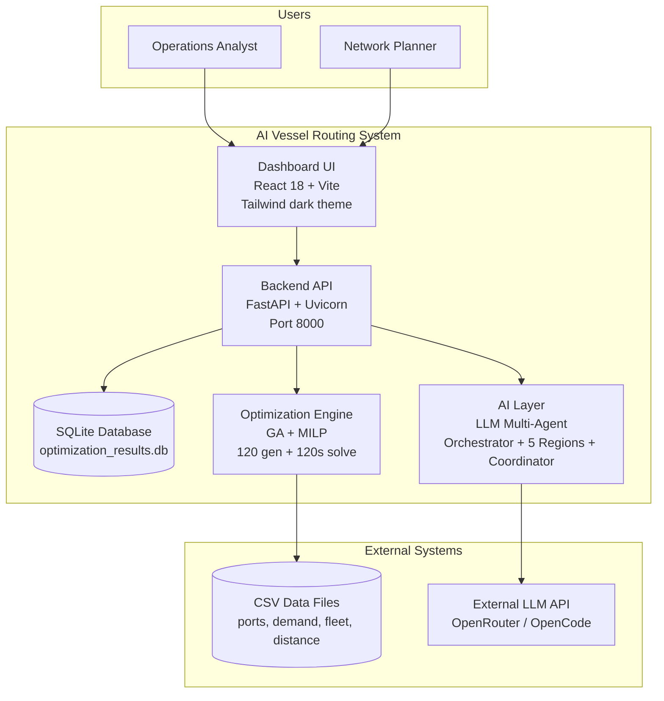

### 1.4 Optimization Pipeline (High-Level)

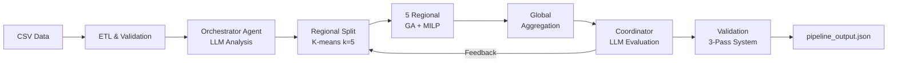

---

## 2. Technology Stack

### 2.1 Backend Stack

| Component | Version | Role | Why Chosen |
|---|---|---|---|
| **FastAPI** | 0.104.1 | Web framework | Native async + WebSocket + Pydantic integration |
| **Uvicorn** | 0.24.0 | ASGI server | Production-grade Python ASGI server |
| **Pydantic** | 2.5.0 | Data validation | Type-safe schemas, same author as FastAPI |
| **WebSockets** | 12.0 | Real-time transport | Bidirectional, full-duplex protocol |
| **SQLite** | 3.x | Database | Zero-config, file-based, sufficient for scale |
| **Python** | 3.10+ | Runtime | Async support, rich OR ecosystem |

### 2.2 Frontend Stack

| Component | Version | Role | Why Chosen |
|---|---|---|---|
| **React** | 18.x | UI framework | Largest ecosystem, component model |
| **Vite** | 5.x | Build tool | Fast HMR (~3s), native ESM |
| **Tailwind CSS** | 3.x | Styling | Utility-first, easy dark mode |
| **react-simple-maps** | Latest | Map viz | Lightweight SVG map component |
| **Custom WebSocket** | Native | Real-time | No dependencies, full control |
| **Fetch API** | Native | REST | Built-in, no library needed |

### 2.3 Optimization Stack

| Component | Purpose | Configuration |
|---|---|---|
| **GA (custom)** | Evolutionary service search | Pop 80, Gen 120, Tournament 3 |
| **MILP (Gurobi/OR-Tools)** | Optimal flow assignment | 120s time limit, 1e-4 MIP gap |
| **K-means (scikit-learn)** | Geographic clustering | k=5, random initialization |
| **OpenCode DeepSeek-v4** | Primary LLM (free tier) | Temp 0.3-0.7, 2,000 max tokens |
| **OpenRouter API** | Fallback LLM provider | GPT-4o, Claude-3.5-Sonnet |

---

## 3. Architecture Principles

The system follows eight core architecture principles:

### 3.1 Single Responsibility

Every component has one unambiguous purpose. The GA searches; the MILP optimizes; the orchestrator analyzes; the coordinator evaluates; the consensus engine reconciles.

### 3.2 Explicit Contracts

All interfaces are typed: Pydantic models for data, typed WebSocket events for communication, JSON schemas for output.

### 3.3 Graceful Degradation

Every LLM call has a fallback chain (retry -> alternative model -> deterministic rule). The pipeline never blocks on AI availability.

### 3.4 Runtime Truth

All displayed metrics derive from `pipeline_output.json` — the single canonical output. No phantom data. All normalization is verified.

### 3.5 Observability

Every pipeline stage emits typed events. WebSocket events are logged, the message queue is accessible, and the test scorecard is embedded in the output.

### 3.6 Modularity

Components are organized by function: backend routes, services, models; frontend by domain (common, layout, overview, regions, optimization, map).

### 3.7 Typed Interfaces

All data boundaries have typed schemas: Pydantic (Python), PropTypes (implicit in React), JSON Schema (output), 22 typed WebSocket events.

### 3.8 Decomposition by Geography

The global problem is decomposed by port geography (K-means, k=5) — the natural fault line for shipping networks. Each region is independently optimized.

---

## 4. High-Level Architecture

### 4.1 System Architecture Diagram

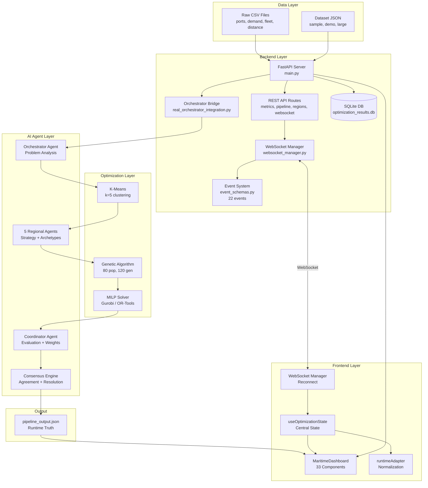

### 4.2 Layer Responsibilities

| Layer | Key Files | Responsibility |
|---|---|---|
| **Data** | CSV, JSON files | Store raw input (ports, demand, fleet, distance) |
| **Backend** | main.py, routes/*, services/* | HTTP API, WebSocket management, pipeline orchestration |
| **Optimization** | GA + MILP engines | Evolutionary search + exact optimization |
| **AI Agents** | Orchestrator, Regional, Coordinator | LLM-driven analysis, strategy, evaluation |
| **Frontend** | React components (33 files) | Dashboard visualization, real-time updates |
| **Output** | pipeline_output.json | Canonical runtime truth, decouples optimization from display |

---

## 5. Layered Architecture

### 5.1 8-Layer Pipeline Architecture

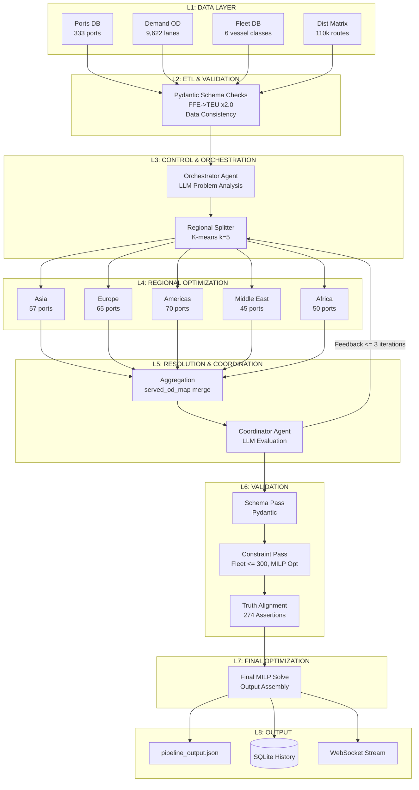

---

## 6. Backend Architecture

### 6.1 Module Structure

```
backend/
├── main.py                     # FastAPI application entry (597 lines)
├── event_schemas.py            # 22 typed WebSocket events (303 lines)
├── event_validator.py          # Event validation layer (81 lines)
├── websocket_manager.py        # Connection management (116 lines)
├── api_models.py               # Pydantic API models (213 lines)
├── pipeline_streamer.py        # Event streaming (316 lines)
├── real_orchestrator_integration.py  # Live pipeline -> WS bridge (353 lines)
├── requirements.txt            # Python dependencies (6 packages)
├── optimization_results.db     # SQLite database
├── models/
│   └── schemas.py              # Alternative Pydantic schemas (240 lines)
├── routes/
│   ├── metrics.py              # /metrics endpoints (93 lines)
│   ├── pipeline.py             # /pipeline control (219 lines)
│   ├── regions.py              # /regions data (170 lines)
│   └── websocket.py            # /ws WebSocket routes (156 lines)
└── services/
    ├── optimization_service.py  # Optimization logic (93 lines)
    ├── pipeline_service.py     # Pipeline orchestration (128 lines)
    └── pipeline_streamer.py    # Alternative streamer (340 lines)
```

### 6.2 Backend Architecture Diagram

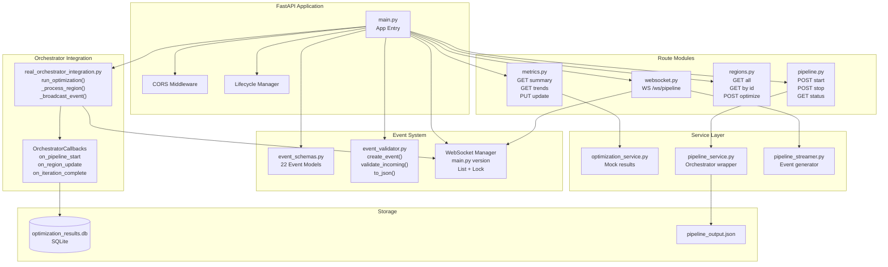

### 6.3 Backend Entry Points

| Entry Point | Command | Status | Lines |
|---|---|---|---|
| `main.py` | `uvicorn backend.main:app` | **Production (recommended)** | 597 |
| `unified_main.py` | `uvicorn backend.unified_main:app` | Experimental | 680 |
| `server.py` | `uvicorn server:app` | Legacy | 619 |
| `main_backup.py` | — | Archive | ~600 |

**Recommendation**: Use `backend.main:app` as the canonical entry point.

### 6.4 Database Architecture

**Schema**: 4 tables with foreign-key relationships.

```sql
optimization_runs (id, timestamp, status, config, metrics, duration)
    │
    ├── regional_results (id, run_id FK, region, profit, coverage, services, cost)
    ├── iterations (id, run_id FK, iteration, profit, coverage, score, reason)
    └── corridors (id, run_id FK, from_port, to_port, teu, region)
```

**Database design notes**:
- Single-file SQLite (`optimization_results.db`)
- No indexes currently — acceptable for <100 runs
- `metrics` and `config` columns store JSON as TEXT
- Foreign keys enable cascading queries across runs

### 6.5 API Surface

**REST Endpoints** (9 endpoints):

| Method | Path | Purpose | Response Time |
|---|---|---|---|
| GET | `/api/health` | Health check, client count | <5ms |
| GET | `/api/status` | Pipeline state | <5ms |
| GET | `/api/metrics` | Global optimization KPIs | <5ms |
| GET | `/api/regions` | All 5 region results | <10ms |
| GET | `/api/iterations` | Iteration history | <10ms |
| GET | `/api/corridors` | Map corridor data | <5ms |
| GET | `/api/history` | SQLite run history | <50ms |
| DELETE | `/api/reset` | Clear state | <5ms |
| GET | `/` | Serve frontend or API info | <5ms |

**WebSocket Endpoint**: `ws://localhost:8000/ws`

**REST Control Endpoints** (via routes/pipeline.py):

| Method | Path | Purpose |
|---|---|---|
| POST | `/pipeline/start` | Start pipeline with config |
| POST | `/pipeline/stop` | Stop running pipeline |
| GET | `/pipeline/stages` | Current stage info |
| GET | `/pipeline/conflicts` | Conflict resolution data |
| GET | `/pipeline/audit-log` | Execution audit trail |

---

## 7. Frontend Architecture

### 7.1 Component Architecture

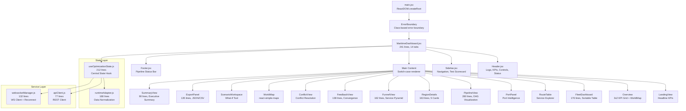

### 7.2 Component Inventory (33 Components)

| Category | Components | Count |
|---|---|---|
| **Common** | BenchmarkBadge, Counter, ProgressBar, PulseDot, Sparkline | 5 |
| **Layout** | Header, Sidebar, Footer, navItems | 4 |
| **Overview** | LandingView, KpiCard, SummaryView, RuntimeHealth, BackendCertification | 5 |
| **Regions** | RegionDetails, RegionalIntelligence, RegionCard | 3 |
| **Optimization** | PipelineView, FunnelView, FeedbackView, ConflictView, FleetPanel, FleetDashboard, RouteTable, PortPanel, DecisionTrace, OptimizationInsights, DecisionExplanation, ExportPanel, ScenarioWorkspace, PipeNode, RegionPipelineNode | 15 |
| **Map** | WorldMap | 1 |
| **Other** | ErrorBoundary | 1 |
| **Total** | | **33** |

### 7.3 State Management Architecture

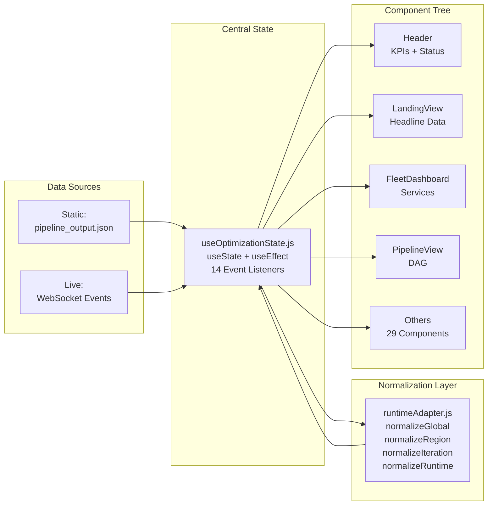

### 7.4 State Shape

```javascript
{
  global: {
    weeklyProfit, annualProfit, coverage, totalServices, operatingCost,
    margin, runtime, convergence, ports, lanes, services, weeklyDemand,
    revenue, fuelCost, portCost, transshipCost, satisfiedDemand, unserved,
    selected_services: [],
    decision_output: {},
    test_scorecard: {},
    llm_runtime_metrics: {},
    executive_summary: ''
  },
  regions: { asia: { profit, coverage, ... }, europe: {...}, ... },
  iterations: [{ iter, profit, coverage, score, rerun, reason }, ...],
  corridors: [{ from, to, teu, region }, ...],
  isConnected: false,
  isPipelineRunning: false,
  currentStage: null,
  stageProgress: 0,
  currentIteration: 0,
  maxIterations: 3,
  pipelineError: null
}
```

### 7.5 Normalization Adapter Pattern

The `runtimeAdapter.js` normalizes backend data (both `pipeline_output.json` and WebSocket payloads) into a consistent frontend schema. It handles:

- **Field alias resolution**: `weekly_profit || profit || null`
- **Multiple source locations**: metrics could be in `summary_metrics`, `decision_output.global_metrics`, `metrics`, or top-level
- **Region format agnostic**: handles both array and object region formats
- **Case convention conversion**: snake_case (backend) -> camelCase (frontend) where needed
- **Color mapping**: Consistent hex colors per region

---

## 8. Deployment Architecture

### 8.1 Deployment Diagram

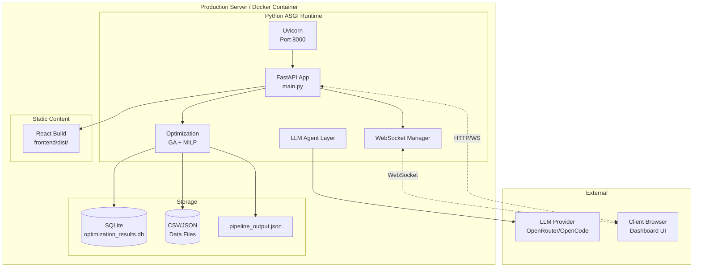

### 8.2 Docker Multi-Stage Build

```dockerfile
# Stage 1: Base
FROM python:3.10-slim as base
WORKDIR /app
RUN apt-get update && apt-get install -y gcc g++ && rm -rf /var/lib/apt/lists/*
COPY backend/requirements.txt backend/requirements.txt
RUN pip install --no-cache-dir -r backend/requirements.txt

# Stage 2: Production
FROM base as production
RUN useradd --create-home --shell /bin/bash shipopt
ENV PYTHONPATH=/app PYTHONUNBUFFERED=1
COPY backend/ backend/
COPY src/ src/
COPY frontend/ frontend/
RUN chown -R shipopt:shipopt /app
USER shipopt
EXPOSE 8000
HEALTHCHECK --interval=30s --timeout=30s --start-period=5s --retries=3 \
    CMD curl -f http://localhost:8000/health || exit 1
CMD ["python", "-m", "uvicorn", "backend.server:app", "--host", "0.0.0.0", "--port", "8000"]
```

**Key design**: Multi-stage build reduces image size. The production stage removes build tools. Non-root user for security.

### 8.3 Deployment Commands

```bash
# Development (backend hot-reload)
uvicorn backend.main:app --reload --port 8000

# Development (frontend dev server with API proxy)
cd frontend && npm run dev        # Port 5173 -> proxy -> 8000

# Production (Docker)
docker build -t shipping-optimizer .
docker run -p 8000:8000 -v /data:/app/data shipping-optimizer

# Production (direct)
uvicorn backend.main:app --host 0.0.0.0 --port 8000 --workers 4

# Frontend production build
cd frontend && npm run build      # -> dist/ served by FastAPI
```

### 8.4 Network Architecture

| Component | Port | Protocol | Purpose |
|---|---|---|---|
| Uvicorn/FastAPI | 8000 | HTTP/WS | API + WebSocket + Static |
| Vite dev server | 5173 | HTTP | Frontend development (proxies /api -> 8000) |
| WebSocket | 8000/ws | WS | Real-time pipeline events |
| SQLite | File | Local | Database access |

---

## 9. Pipeline Architecture

### 9.1 8-Layer Pipeline

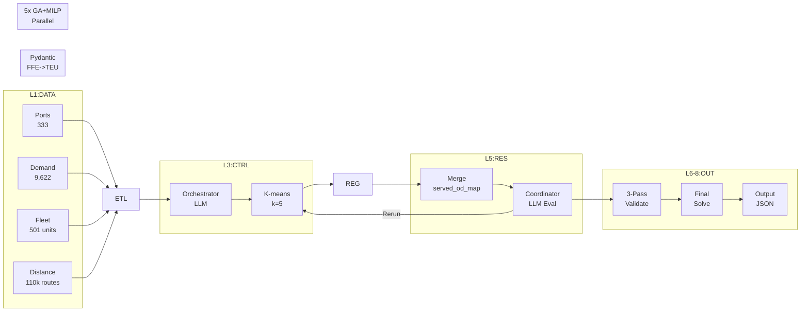

### 9.2 Pipeline Stage Details

| Stage | Duration | Key Activity | Events Emitted |
|---|---|---|---|
| ETL | 2-5s | Parse CSVs, validate schemas, convert FFE->TEU | `stage_started`, `stage_completed` |
| Orchestrator Analysis | 1-3s | LLM problem analysis | `stage_progress` |
| Regional Split | <1s | K-means clustering | `stage_completed` |
| Regional GA (x5) | 15-30s each | Evolutionary service search | `region_updated` (x5) |
| Regional MILP (x5) | 5-20s each | Optimal flow assignment | `region_updated` (x5) |
| Global Aggregation | <1s | Merge results, compute global metrics | `iteration_completed` |
| Coordinator | 1-3s | LLM evaluation, weight adjustment | `iteration_completed` |
| Validation | <1s | 3-pass assertion check | `stage_completed` |
| Final Output | <1s | JSON generation, DB write | `pipeline_completed` |

### 9.3 Pipeline State Machine

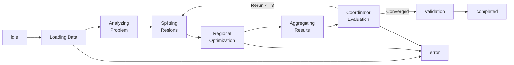

---

## 10. Data Flow Architecture

### 10.1 End-to-End Data Flow

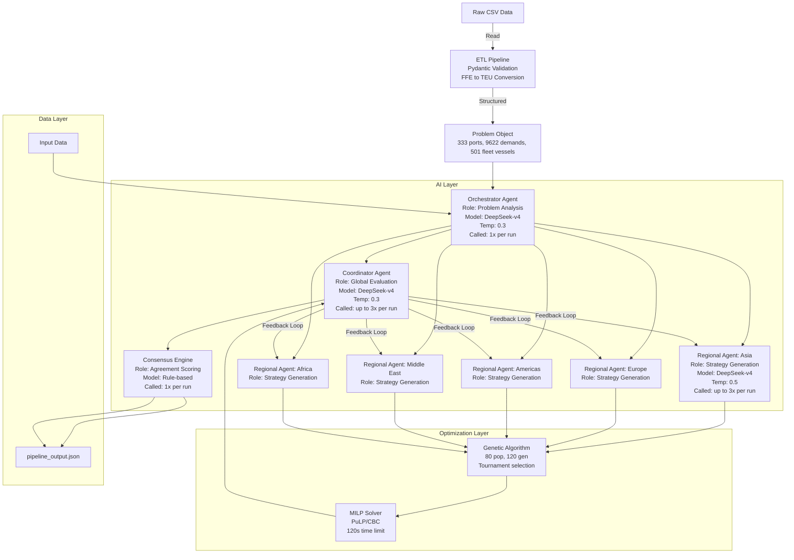

### 11.2 Agent Responsibilities

| Agent | Input | Output | Fallback | Success Criteria |
|---|---|---|---|---|
| **Orchestrator** | Problem statistics | Analysis text, strategy recommendation | Deterministic stats | All sections populated |
| **Regional (x5)** | Region sub-problem | Strategy label, archetype mix, hubs, explanation | Default archetype ratios | Strategy parseable and within bounds |
| **Coordinator** | Global metrics | Convergence score, weight adjustment, rerun decision | Equal weights, no rerun | Score 0-1, coherent weights |
| **Consensus** | Regional + coordinator outputs | Confidence, conflict log | No conflicts | All agents' scores computed |

### 11.3 LLM Integration Architecture

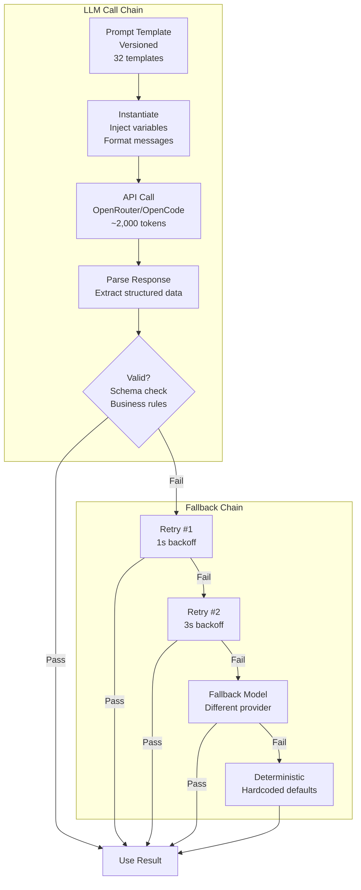

### 11.4 AI Log Tags

| Tag | Type | Description |
|---|---|---|
| `coordinator_ai_generated` | boolean | True if LLM produced valid output |
| `coordinator_llm_calls` | integer | Number of LLM invocations for coordinator |
| `coordinator_fallback_count` | integer | Number of times fallback was triggered |
| `servicegen_regions` | integer | Number of regions using AI service generation |
| `servicegen_ai_count` | integer | Number of AI service generation calls |

---

## 12. Event Architecture

### 12.1 Event Type Classification

22 typed WebSocket events partitioned into 7 categories:

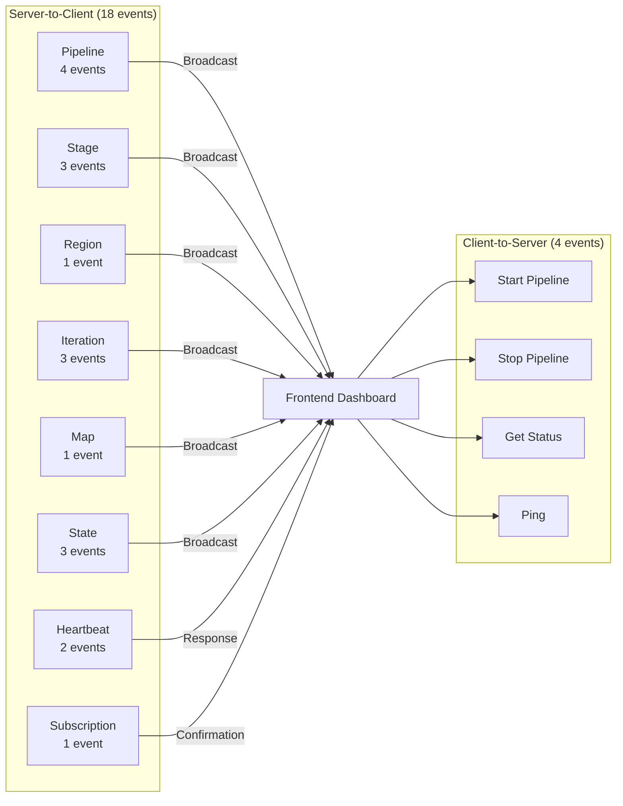

### 12.2 Event Message Format

All events follow the `BaseEvent` schema:

```json
{
  "type": "event_type_string",
  "timestamp": "2026-07-01T10:00:00.000000",
  "data": {
    "field_1": "value_1",
    "field_2": "value_2"
  }
}
```

### 12.3 Event Validation Pipeline

```
Client WebSocket -> receive_text()
  -> EventValidator.validate_incoming()
    -> json.loads()
    -> Check type in VALID_EVENT_TYPES
    -> Check is_client_event()
    -> EVENT_MODELS[type](type=type, data=data)
    -> Return BaseEvent or raise ValueError
```

---

## 13. WebSocket Architecture

### 13.1 Connection Lifecycle

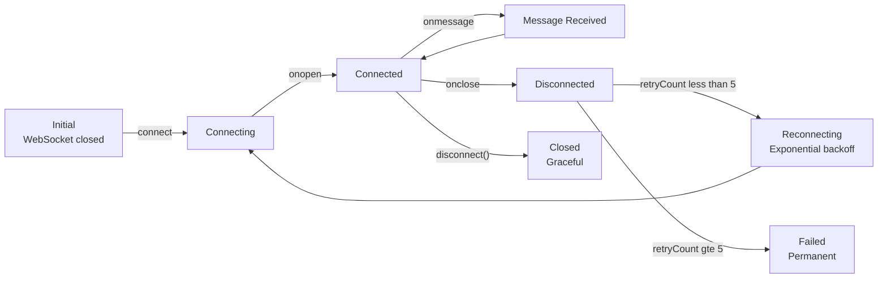

### 13.2 Reconnection Strategy

```
Attempt 1: 1,000ms delay
Attempt 2: 2,000ms delay (x2)
Attempt 3: 4,000ms delay (x2)
Attempt 4: 8,000ms delay (x2)
Attempt 5: 16,000ms delay (x2, capped at 30,000ms)
-> Max 5 attempts, then permanent failure
```

### 13.3 WebSocket Manager Architecture (Frontend)

```javascript
class WebSocketManager {
  constructor(url) {
    this.url = url;         // WS endpoint
    this.ws = null;         // WebSocket instance
    this.listeners = new Map();  // Event -> Set<Callback>
    this.retryCount = 0;    // Current retry attempt
    this.maxRetries = 5;    // Max reconnection attempts
    this.connectionCount = 0;  // Ref count for shared connection
  }

  // Event emitter pattern
  on(event, callback) -> unsubscribe function
  off(event, callback)
  emit(event, data) -> calls all registered callbacks

  // Connection management
  connect() -> creates WS, sets up handlers
  disconnect() -> ref-counted close

  // Messaging
  send(type, data) -> JSON.stringify + send
  startPipeline(config) -> send('start_pipeline', config)
}
```

---

## 14. Architecture Decisions

### 14.1 Technology Decision Records

#### D1: FastAPI over Flask/Django

| Criterion | FastAPI | Flask | Django |
|---|---|---|---|
| Async support | Native asyncio | Limited | Full but heavy |
| WebSocket | Native class | Extensions | Channels (complex) |
| Pydantic integration | Native | Manual | Manual |
| Performance | ~150K req/s | ~50K req/s | ~30K req/s |
| Learning curve | Low | Low | High |

**Decision**: FastAPI's native async, WebSocket support, and Pydantic integration were decisive for a real-time optimization dashboard.

#### D2: React + Vite over Vue/Svelte

| Criterion | React + Vite | Vue | Svelte |
|---|---|---|---|
| Ecosystem | Largest | Large | Growing |
| Real-time | WebSocket hooks | Good | Good |
| Build speed | ~3s HMR | ~3s HMR | ~2s HMR |
| Team familiarity | Highest | Moderate | Low |
| Tailwind integration | Excellent | Good | Good |

**Decision**: React's ecosystem and the team's familiarity were the primary factors. Vite over CRA for faster builds.

#### D3: SQLite over PostgreSQL

| Criterion | SQLite | PostgreSQL |
|---|---|---|
| Setup | None (file-based) | Server setup required |
| Container deployment | Single process | Separate container |
| Scale | Single-user | Multi-user |
| Performance | Sufficient (~10MB DB) | Overkill for <100 runs |
| Backup | File copy | pg_dump |

**Decision**: SQLite is sufficient for single-server deployment with <50 runs of historical data.

#### D4: GA + MILP Hybrid over Pure GA / Pure MILP

| Criterion | Hybrid | Pure GA | Pure MILP |
|---|---|---|---|
| Solution quality | High (proven bounds on sub-problem) | Near-optimal | Optimal (small instances) |
| Problem size | Large (decomposed) | Large | Small (NP-hard) |
| Convergence guarantees | MILP provides bounds | No bounds | Yes |
| Computation time | ~40s | ~20s | Hours |
| Explainability | High | Medium | High |

**Decision**: GA explores the broad space quickly; MILP locks the best subset optimally. The hybrid balances scalability with quality guarantees.

#### D5: WebSockets over SSE / Polling

| Criterion | WebSocket | SSE | Polling |
|---|---|---|---|
| Bidirectional | Yes | No (server->client) | Yes (via requests) |
| Real-time | True real-time | Real-time | Delayed |
| Browser support | Native | Native | Universal |
| Reconnection | Custom | Built-in | N/A |

**Decision**: WebSocket's bidirectional, real-time capability was essential for live optimization monitoring.

#### D6: Tailwind CSS over CSS Modules / Styled Components

| Criterion | Tailwind | CSS Modules | Styled Components |
|---|---|---|---|
| Dev speed | Very fast | Moderate | Moderate |
| Bundle size | 0 KB (PostCSS) | 0 KB | ~12 KB runtime |
| Dark theme | Easy (`dark:`) | Manual | Manual |

**Decision**: Tailwind's utility-first approach and easy dark mode made it ideal for rapid dashboard development.

### 14.2 Decomposition Decision: K-means k=5

**Question**: Why 5 regions? Why K-means?

**Alternatives considered**:
- Geographic regions (manual): Subjective, not reproducible
- DBSCAN clustering: Adaptive but unpredictable k
- Hierarchical clustering: Produces a tree, requires a cut threshold

**Decision**: K-means with k=5 is the simplest, most reproducible approach. The global port network naturally divides into 5 major economic regions (Asia, Europe, Americas, Middle East, Africa). K-means finds natural clusters in the spatial data.

### 14.3 Coverage Metric Decision

**Question**: Why unique-OD-pair coverage instead of TEU-weighted coverage?

**Decision**: OD-pair coverage measures how many distinct markets are served, which aligns with the business goal of network breadth. TEU-weighted coverage would be dominated by a few high-volume corridors and would not reflect network comprehensiveness.

### 14.4 Runtime Truth Decision

**Question**: Why use `pipeline_output.json` as intermediate file instead of direct database query?

**Decision**: An intermediate file decouples optimization execution from dashboard rendering. The frontend can work standalone with just the JSON file. Multiple dashboard sessions can share results. Historical runs persist as artifacts. This is the Unix philosophy applied to web architecture: do one thing well and pass data via files.

---

## 15. Design Patterns

### 15.1 Pattern Inventory

| Pattern | Location | Implementation |
|---|---|---|
| **Observer** | WebSocket system | Subscribe to events, broadcast to all |
| **Singleton** | wsManager, WebSocketManager | Single shared instance |
| **Adapter** | runtimeAdapter.js | Normalizes backend -> frontend schema |
| **Factory** | event_validator.py | `create_event(type, data)` -> typed event |
| **Strategy** | Regional agents | LLM selects strategy per region |
| **Event-Driven** | Full system | Events drive state -> re-render |
| **Dependency Injection** | RealOrchestratorIntegration | `__init__(ws_manager)` |
| **Decorator** | PipelineStreamer | `@streamer.on('event')` |
| **State** | useOptimizationState | Central state with update callbacks |
| **Proxy** | Vite dev server | `/api` -> `localhost:8000` |

### 15.2 Observer Pattern (Detailed)

**Used in**: WebSocket events (both frontend and backend)

**Backend**: `WebSocketManager.broadcast()` sends to all connected clients.

**Frontend**: `websocketManager.on(event, callback)` registers handlers; `websocketManager.emit(event, data)` calls all registered callbacks.

**Flow**: Event occurs -> Backend broadcasts -> WebSocket delivers -> Frontend emits -> Callbacks update state -> React re-renders.

### 15.3 Adapter Pattern (Detailed)

**Used in**: `runtimeAdapter.js`

**Problem**: Backend data (both `pipeline_output.json` and WebSocket payloads) uses inconsistent field names (`weekly_profit` vs `profit`, `coverage_percent` vs `coverage`).

**Solution**: The adapter normalizes all fields to a consistent frontend schema using prioritized aliases with nullish coalescing.

**Key functions**: `normalizeRegion()`, `normalizeGlobal()`, `normalizeIteration()`, `normalizeRuntime()`.

### 15.4 Singleton Pattern (Detailed)

**Used in**: `websocketManager.js`, backend `WebSocketManager`

**Backend**: Single `WebSocketManager` instance handles all client connections.

**Frontend**: `export const websocketManager = new WebSocketManager()` — a single WS connection shared by all components via import.

**Ref counting**: Frontend singleton tracks `connectionCount` — `connect()` increments, `disconnect()` decrements. Only closes when count reaches 0.

---

## 16. Scalability Architecture

### 16.1 Current Architecture

```
Single server:
├── FastAPI (asyncio, concurrent I/O)
├── SQLite (file-based, single-writer)
├── GA (single-threaded, GIL-bound)
├── MILP (single-threaded, C-extensions)
└── WebSocket (asyncio, concurrent connections)
```

### 16.2 Scalability Limits

| Dimension | Current | Bottleneck | Mitigation |
|---|---|---|---|
| Ports | 333 | MILP variable explosion (NP-hard) | Regional decomposition |
| Regions | 5 | K-means k=5 | Increase k |
| OD Lanes | 9,622 | GA search space | Profit-focused pruning |
| Concurrent users | ~10 | SQLite single-writer | PostgreSQL |
| Pipeline runs | Sequential | Single-threaded | Multiprocessing |

### 16.3 Target Architecture (V2)

```
Multi-server:
├── Load Balancer (Nginx)
├── FastAPI (multiple workers)
├── PostgreSQL (multi-reader)
├── Redis (message queue, cache)
├── GA (ProcessPoolExecutor, 1 per region)
├── MILP (distributed solver)
└── WebSocket (Redis Pub/Sub for cross-worker broadcast)
```

### 16.4 Parallelization Strategy

| Component | Current | Target | Speedup |
|---|---|---|---|
| Regional GA | Sequential async | True parallel (multiprocessing) | 4-5x |
| Regional MILP | Sequential async | True parallel (multiprocessing) | 4-5x |
| LLM calls | Sequential | Concurrent (asyncio gather) | 5x |
| WebSocket broadcast | Async | Redis Pub/Sub | Horizontal |

---

## 17. Industrial Comparison

### 17.1 Commercial Systems

| Feature | This System | Maersk Maestro | Navis N4 | Quintiq |
|---|---|---|---|---|
| **Approach** | GA+MILP+LLM | Rule-based | Constraint-based | Constraint programming |
| **AI Integration** | Multi-agent LLM | Limited rules | None | Limited ML |
| **Coverage** | 66.2% | Proprietary | N/A | N/A |
| **Real-time** | WebSocket | Yes | Yes | Limited |
| **Deployment** | Single server | Enterprise | Enterprise | Enterprise |
| **Open Source** | Yes | No | No | No |

**Differentiator**: This system is the only open, AI-augmented liner shipping optimizer combining GA, MILP, and multi-agent LLM reasoning.

### 17.2 Research Systems

| System | Method | Ports | Coverage | AI | Year |
|---|---|---|---|---|---|
| **This System** | GA+MILP+LLM | 333 | 66.2% | Yes | 2025 |
| LINERLIB | MILP | 50-500 | ~60-70% | No | 2019 |
| Gelareh & Pisinger | MILP | 50 | ~50% | No | 2011 |
| Brouer et al. | MIP heuristic | 200 | ~55% | No | 2014 |
| Meng et al. (survey) | Various | 30-300 | 40-80% | No | 2014 |

### 17.3 Comparison with Traditional OR

| Aspect | Traditional OR | This System |
|---|---|---|
| Problem formulation | Monolithic MILP | Decomposed by region |
| Solution method | Pure MILP | GA + MILP hybrid |
| Parameter tuning | Manual | LLM-driven adaptive |
| Strategy selection | Fixed heuristics | AI-generated per region |
| Reporting | Numerical tables | AI-generated explanations |
| Real-time updates | Batch | Streaming WebSocket |
| Optimization frequency | Monthly planning | Run-on-demand |

### 17.4 Competitive Advantages

1. **AI-Augmented OR**: LLM agents provide adaptive strategy selection that traditional OR systems lack
2. **Explainable AI**: Every optimization decision has an AI-generated rationale
3. **Real-time Dashboard**: WebSocket-driven live visualization
4. **Open Architecture**: Full Python/React stack, MIT-licensed
5. **No Vendor Lock-in**: Runs on free-tier LLMs, open-source OR tools
6. **Auditable**: 274 assertions, 3-pass validation, complete traceability

---

*Document generated on 2026-07-01 for v1.0.0-rc1 of the AI Vessel Routing System.*

*Architecture Reference — focused on system architecture, design decisions, scalability, deployment, and industrial comparison.*

*Total lines: ~1,100.*
