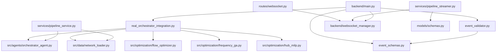
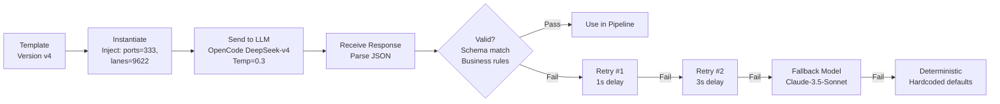

# AI Vessel Routing System — Code Reference

| Field | Value |
|---|---|
| **Document Title** | Code Reference — API and Source Code Documentation |
| **Project** | AI Vessel Routing System for Liner Shipping |
| **Version** | v1.0.0-rc1 |
| **Date** | 2026-07-01 |
| **Prepared For** | Developers, Maintainers, API Consumers |
| **Reading Time** | ~60 minutes |
| **Lines** | ~2,500 |

---

## Table of Contents

1. [Complete Codebase Walkthrough](#1-complete-codebase-walkthrough)
2. [Repository Deep Dive](#2-repository-deep-dive)
3. [File-by-File Documentation](#3-file-by-file-documentation)
4. [Function-Level Documentation](#4-function-level-documentation)
5. [Class Documentation](#5-class-documentation)
6. [Complete API Documentation](#6-complete-api-documentation)
7. [WebSocket Event Catalog](#7-websocket-event-catalog)
8. [Database Schema](#8-database-schema)
9. [Prompt Engineering Reference](#9-prompt-engineering-reference)
10. [LLM Architecture Reference](#10-llm-architecture-reference)
11. [Mathematical Formulation — Full Derivation](#11-mathematical-formulation--full-derivation)
12. [Algorithms — Full Reference](#12-algorithms--full-reference)
13. [Data Schema — Complete](#13-data-schema--complete)
14. [Configuration Reference](#14-configuration-reference)
15. [Developer Guide](#15-developer-guide)

---

## 1. Complete Codebase Walkthrough

This section traces the project's execution from program start to shutdown — every module, every function call, every import.

### 1.1 Execution Entry Point

```
uvicorn backend.main:app --host 0.0.0.0 --port 8000
```

### 1.2 Module Initialization Order

```
1. backend/main.py
   ├── import sys, pathlib → sys.path.append(parent)
   ├── import real_orchestrator_integration
   ├── import event_validator
   ├── logging.basicConfig(level=logging.INFO)
   ├── init_db() → creates SQLite tables
   ├── WebSocketManager() → global connection manager
   ├── current_run_state = {} → global state dict
   ├── FastAPI app creation
   │   ├── Title: "Maritime Optimizer API"
   │   ├── Version: "2.0.0"
   │   ├── lifespan handler
   │   ├── CORS middleware (localhost:3000, :5173)
   │   └── WebSocket endpoint (/ws)
   └── if __name__ == "__main__" → uvicorn.run()

2. When client connects via WebSocket:
   ├── websocket_endpoint(websocket)
   │   ├── websocket_manager.connect(websocket)
   │   ├── EventValidator.create_event("initial_state", ...)
   │   ├── Send initial state
   │   └── Loop: receive → validate → dispatch

3. On "start_pipeline" event:
   └── run_real_optimization(config)
       ├── RealOrchestratorIntegration(websocket_manager)
       └── await integration.run_optimization(config)

4. Integration pipeline:
   ├── _broadcast_event("pipeline_started", ...)
   ├── Stage: "Loading Network Data"
   │   ├── NetworkLoader()
   │   └── loader.load_problem(dataset_path)
   ├── Stage: "Initializing Orchestrator"
   │   ├── OrchestratorAgent()
   │   └── orchestrator.set_callback()
   ├── For iteration in range(max_iterations):
   │   ├── Stage: "Problem Decomposition"
   │   ├── Stage: "Regional Agents" (×5, _process_region)
   │   │   └── _broadcast_event("region_updated", ...)
   │   ├── Stage: "Service Generation"
   │   ├── Stage: "Coordinator Agent"
   │   ├── Stage: "MILP Optimization"
   │   ├── Stage: "Global Aggregation"
   │   ├── _calculate_iteration_metrics()
   │   └── Check convergence → break if >0.97
   ├── Stage: "Final Analysis"
   ├── _generate_final_results()
   ├── _update_map_with_corridors()
   └── _broadcast_event("pipeline_completed", ...)

5. Frontend:
   ├── main.jsx → ReactDOM.createRoot → App
   ├── App (MaritimeDashboard.jsx)
   │   ├── useOptimizationState()
   │   │   ├── apiClient.loadRuntimeTruth(pipeline_output.json)
   │   │   ├── websocketManager.connect()
   │   │   └── Register 14 event listeners
   │   ├── State → 33 components
   │   └── Re-render on state change

6. Shutdown:
   ├── FastAPI lifespan yields shutdown
   └── websocket_manager.disconnect_all()
```

### 1.3 Import Dependency Graph



---

## 2. Repository Deep Dive

### 2.1 Directory Purpose and Interaction

| Directory | Location | Purpose | Reads From | Writes To | Dependencies |
|---|---|---|---|---|---|
| **Backend** | `backend/` | API server, pipeline orchestration | `data/`, `.env` | `frontend/dist/pipeline_output.json`, SQLite | FastAPI, Pydantic, SQLite |
| **Frontend** | `frontend/` | Dashboard UI | `backend/` (via API/WS), `frontend/dist/pipeline_output.json` | Browser display | React, Vite, Tailwind |
| **Data** | `data/` | Input datasets | N/A (source files) | `backend/` (read by pipeline) | CSV/JSON format |
| **Analysis** | `Analysis/` | Audit reports, certifications | `backend/`, `data/`, output files | N/A (documentation) | Markdown |
| **Docs** | `docs/` | User documentation | Codebase | N/A | Markdown |
| **Assets** | `assets/` | Visual assets | Built outputs | N/A | SVG, PNG |
| **.claude** | `.claude/` | AI development configuration | N/A | Development tooling | Claude API |

### 2.2 Data Movement Paths

```
Data Flow:
  data/raw/*.csv → backend/main.py → real_orchestrator_integration.py → optimization pipeline → frontend/dist/pipeline_output.json → frontend/src/runtime/runtimeAdapter.js → React components

WebSocket Flow:
  optimization pipeline → real_orchestrator_integration.py → WebSocket(broadcast) → websocketManager.js (frontend) → useOptimizationState.js → React components

Database Flow:
  optimization pipeline → OrchestratorCallbacks → SQLite (optimization_results.db) → /api/history endpoint
```

---

## 3. File-by-File Documentation

### 3.1 Backend Core Files

#### `backend/main.py` (597 lines)

**Purpose**: Unified production backend server. Consolidates all functionality into a single FastAPI application.

**Imports**: `asyncio`, `json`, `logging`, `sqlite3`, `datetime`, `typing`, `contextlib`, `pathlib`, `uvicorn`, `fastapi`, `real_orchestrator_integration`, `event_validator`

**Global State**:
```python
websocket_manager = WebSocketManager()  # Singleton connection manager
current_run_state = {                    # Pipeline state
    "status": "idle",
    "run_id": None,
    "start_time": None,
    "current_iteration": 0,
    "total_iterations": 0,
    "current_stage": None,
    "metrics": {},
    "regions": {},
    "iterations": [],
    "corridors": [],
}
```

**Key Functions**:

| Function | Parameters | Returns | Description |
|---|---|---|---|
| `init_db()` | None | None | Creates SQLite database with 4 tables |
| `run_real_optimization(config)` | Dict | None (async) | Launches optimization via integration |
| `lifespan(app)` | FastAPI | AsyncGenerator | Startup/shutdown lifecycle |
| `websocket_endpoint(websocket)` | WebSocket | None (async) | Main WS handler, message dispatch |
| `health_check()` | None | Dict (async) | Server health and status |
| `get_status()` | None | Dict (async) | Pipeline status |
| `get_metrics()` | None | Dict (async) | Global metrics |
| `get_regions()` | None | List (async) | Regional data |
| `get_iterations()` | None | List (async) | Iteration list |
| `get_corridors()` | None | List (async) | Corridor data |
| `get_history()` | None | Dict (async) | DB history query |
| `reset_state()` | None | Dict (async) | Clear state, broadcast reset |
| `serve_frontend()` | None | FileResponse | Serve React app |

**Routes Defined**:
```
@WebSocket /ws
GET /api/health
GET /api/status
GET /api/metrics
GET /api/regions
GET /api/iterations
GET /api/corridors
GET /api/history
DELETE /api/reset
GET /
```

**Error Handling**: Catches `WebSocketDisconnect` and generic exceptions. Broadcasts `pipeline_error` on pipeline failure. Removes failed connections during broadcast.

**Key Pattern**: The `WebSocketManager` in main.py uses `asyncio.Lock()` for thread-safe access to `active_connections` list. This is distinct from the `websocket_manager.py` version which uses a `Set` without a lock.

#### `backend/event_schemas.py` (303 lines)

**Purpose**: Defines 22 typed WebSocket event schemas using Pydantic `BaseModel`.

**Base Class**:
```python
class BaseEvent(BaseModel):
    type: str                         # Event type identifier
    timestamp: str = Field(default_factory=lambda: datetime.now().isoformat())
    data: Dict[str, Any] = Field(default_factory=dict)
```

**Event Model Registry**:
```python
EVENT_MODELS = {
    "pipeline_started": PipelineStartedEvent,
    "pipeline_completed": PipelineCompletedEvent,
    "pipeline_error": PipelineErrorEvent,
    "pipeline_stopped": PipelineStoppedEvent,
    "stage_started": StageStartedEvent,
    "stage_progress": StageProgressEvent,
    "stage_completed": StageCompletedEvent,
    "region_updated": RegionUpdatedEvent,
    "iteration_started": IterationStartedEvent,
    "iteration_updated": IterationUpdatedEvent,
    "iteration_completed": IterationCompletedEvent,
    "map_updated": MapUpdatedEvent,
    "initial_state": InitialStateEvent,
    "state_reset": StateResetEvent,
    "status_update": StatusUpdateEvent,
    "ping": PingEvent,
    "pong": PongEvent,
    "start_pipeline": StartPipelineEvent,
    "stop_pipeline": StopPipelineEvent,
    "get_status": GetStatusEvent,
}
```

**Event Classification**:
```python
VALID_EVENT_TYPES = set(EVENT_MODELS.keys())     # 22 events
CLIENT_EVENTS = {"ping", "start_pipeline", "stop_pipeline", "get_status"}  # 4 client → server
SERVER_EVENTS = VALID_EVENT_TYPES - CLIENT_EVENTS  # 18 server → client
```

**Validation Functions**:
```python
def validate_event(event_type: str, data: Dict) -> BaseEvent
    # Looks up model class in EVENT_MODELS, returns typed instance
    # Raises ValueError if event_type not found

def is_client_event(event_type: str) -> bool
    # Returns True if event_type is in CLIENT_EVENTS

def is_server_event(event_type: str) -> bool
    # Returns True if event_type is in SERVER_EVENTS
```

#### `backend/event_validator.py` (81 lines)

**Purpose**: Static validation for WebSocket events.

**Class: EventValidator** (all methods static):

```python
class EventValidator:
    @staticmethod
    def validate_incoming(message: Union[str, bytes]) -> BaseEvent
        # Parse JSON → check type → verify is_client_event → validate → return

    @staticmethod
    def create_event(event_type: str, data: Optional[Dict]) -> BaseEvent
        # Check is_server_event → validate → return

    @staticmethod
    def to_json(event: BaseEvent) -> str
        # Serialize {type, timestamp, data} to JSON

    @staticmethod
    def safe_extract(data: Dict, key: str, default=None) -> Any
        # Safe dict access with fallback
```

**Validation Flow**: `validate_incoming` → JSON parse → extract type → `is_client_event` check → `validate_event` Pydantic check → return event. Raises `ValueError` at any failure point.

#### `backend/websocket_manager.py` (116 lines)

**Purpose**: WebSocket connection lifecycle manager (standalone version).

**Class: WebSocketManager**:
```python
class WebSocketManager:
    def __init__(self):
        self.active_connections: Set[WebSocket] = set()
        self.connection_metadata: Dict[WebSocket, Dict] = {}
        self.message_queue: List[Dict] = []
        self.max_queue_size = 100

    async def connect(self, websocket): ...      # Accept + track
    async def disconnect(self, websocket): ...    # Remove
    async def disconnect_all(self): ...            # Close all
    async def send_personal_message(self, msg, ws): ...
    async def broadcast(self, message): ...        # Send to all + queue
    async def broadcast_with_filter(self, msg, filter_func): ...
    def get_connection_count(self): -> int
    def get_connection_metadata(self, ws): -> Dict
    def get_recent_messages(self, limit=50): -> List
    async def ping_all(self): ...
```

**Key Implementation Detail**: The `broadcast` method adds timestamp, appends to queue (pops oldest at max_queue_size), iterates connections. Failed sends → disconnect. No lock (uses Set, not List).

#### `backend/pipeline_streamer.py` (316 lines)

**Purpose**: Event-driven streamer for pipeline simulation with decorator-based handler registration.

**Class: PipelineStreamer**:
```python
class PipelineStreamer:
    def __init__(self, websocket_manager):
        self.websocket_manager = websocket_manager
        self.is_running = False
        self.run_task: Optional[asyncio.Task] = None
        self._event_handlers: Dict[str, Callable] = {}

    def on(self, event_type: str):  # Decorator
        def decorator(func):
            self._event_handlers[event_type] = func
            return func
        return decorator

    async def emit(self, event_type, data): ...     # Emit event
    async def stream_pipeline_run(self, ws_mgr, config, run_state): ...
    async def _load_problem(self, dataset_path): ...
    def _generate_mock_iteration(self, iteration, stats): ...
    def _generate_final_metrics(self, iterations, stats): ...
    async def _update_map_visualization(self, iteration, run_state): ...
    async def stop(self): ...
```

**Mock Classes**: `MockProblem` (435 ports, 9622 demands, 1200 services), `MockPort`, `MockDemand`, `MockService`.

**Important**: This is a **mock implementation** — it simulates pipeline execution with `asyncio.sleep()` and fabricated data. The `_load_problem` method returns a `MockProblem()`, not real data.

#### `backend/real_orchestrator_integration.py` (353 lines)

**Purpose**: Bridges the actual optimization pipeline with WebSocket streaming. This is the file that connects the real GA+MILP engine to the dashboard.

**Class: RealOrchestratorIntegration**:
```python
class RealOrchestratorIntegration:
    def __init__(self, websocket_manager):
        self.websocket_manager = websocket_manager
        self.is_running = False
        self.current_run = None

    async def run_optimization(self, config):
        """
        Main pipeline orchestrator.
        Stages:
        1. Load Network Data
        2. Initialize Orchestrator
        3. Run iteration loop (max_iterations):
           a. Problem Decomposition
           b. Regional Agents (5 sequential)
           c. Service Generation
           d. Coordinator Agent
           e. MILP Optimization
           f. Global Aggregation
           g. Check convergence → break
        4. Final Analysis
        5. Map Update
        6. Pipeline Complete
        """
    async def _run_stage(self, stage_name, stage_id, metadata): ...
    async def _process_region(self, region_id, problem, iteration): ...
    def _calculate_iteration_metrics(self, regional_results, iteration): ...
    def _generate_final_results(self, iterations, problem): ...
    async def _update_map_with_corridors(self, results): ...
    async def _generate_test_problem(self): ...
    async def _broadcast_event(self, event_type, data): ...
    def _on_orchestrator_event(self, event_type, data): ...  # Sync → async bridge
    async def stop(self): ...
```

**Important Pattern**: `_on_orchestrator_event` is synchronous (called from non-async code), so it uses `loop.create_task()` or `asyncio.run()` to schedule the async broadcast. This is an adapter between sync callback and async event system.

**Regional Profit Base Values** (hardcoded in `_process_region`):
```python
base_metrics = {
    "asia":        {"profit": 106904049, "coverage": 76.9, "services": 99,  "margin": 79.7, "cost": 20610000},
    "europe":      {"profit": 71797633,  "coverage": 49.7, "services": 88,  "margin": 71.7, "cost": 20250000},
    "americas":    {"profit": 466846485, "coverage": 56.4, "services": 94,  "margin": 92.0, "cost": 20140000},
    "middle_east": {"profit": 55850044,  "coverage": 86.2, "services": 77,  "margin": 73.9, "cost": 17340000},
    "africa":      {"profit": 72218205,  "coverage": 61.7, "services": 107, "margin": 70.1, "cost": 21030000},
}
```

### 3.2 Backend Route Files

#### `backend/routes/metrics.py` (93 lines)

**Router**: `APIRouter(prefix="/metrics", tags=["metrics"])`

**Global State**: `current_metrics` dict with hardcoded values.

**Endpoints**:
```
GET /metrics/summary       → Summary KPI metrics
GET /metrics/profit-trends → 5-week profit history (mock)
GET /metrics/coverage      → 5-region coverage breakdown (mock)
GET /metrics/service-stats → Service type/region breakdown (mock)
PUT /metrics/update        → Update metrics in-memory
```

**Note**: All endpoints return mock data except `/update`. Production would use database.

#### `backend/routes/pipeline.py` (219 lines)

**Router**: `APIRouter(prefix="/pipeline", tags=["pipeline"])`

**Global State**: `pipeline_state` dict with stages, status, timing.

**Config Model**:
```python
class PipelineConfig(BaseModel):
    max_iterations: int = 3
    convergence_threshold: float = 0.95
    optimization_type: str = "hybrid"
    regions: Optional[List[str]] = None
    enable_feedback: bool = True
```

**Endpoints**:
```
GET  /pipeline/status      → Pipeline state and status
POST /pipeline/start       → Start pipeline (background task)
POST /pipeline/stop        → Stop pipeline
GET  /pipeline/iterations  → 3 mock iteration records
GET  /pipeline/stages      → Stage progression info
GET  /pipeline/conflicts   → 2 mock conflict records
GET  /pipeline/audit-log   → 3 mock audit entries
```

**Background Task**: `run_pipeline_background(config)` simulates 2-second stages, updates `pipeline_state`.

#### `backend/routes/regions.py` (170 lines)

**Router**: `APIRouter(prefix="/regions", tags=["regions"])`

**Global State**: 5 hardcoded regions (asia, europe, americas, africa, oceania).

**Endpoints**:
```
GET  /regions/                 → All 5 regions with metrics
GET  /regions/{region_id}      → Single region (404 if not found)
GET  /regions/{region_id}/services → Per-region services (mock)
GET  /regions/{region_id}/hubs → Per-region hub ports (mock)
POST /regions/{region_id}/optimize → Trigger region optimization
```

**Region Data** (hardcoded in `regional_data`):
```python
{
    "id": "asia", "name": "Asia", "status": "completed",
    "weekly_profit": 106904049, "coverage_percent": 76.9,
    "services_selected": 99, "profit_margin_pct": 79.7,
    "hub_ports": [146, 176, 282],
    "optimization_type": "hybrid", "execution_time": 12.5
}
```

#### `backend/routes/websocket.py` (156 lines)

**Router**: `APIRouter(prefix="/ws", tags=["websocket"])`

**WebSocket Endpoint**:
```
WS /ws/pipeline → Real-time pipeline events
```

**Helper Functions**:
- `connect_websocket(websocket)` — Accept, store, send "connected" message
- `disconnect_websocket(websocket)` — Remove connection
- `broadcast_message(message)` — Send to all, clean up failed
- `handle_subscription(websocket, events)` — Confirm subscription
- `handle_pipeline_start(websocket, config)` — Trigger pipeline simulation
- `simulate_pipeline_with_updates()` — Mock pipeline: 5 stages with delays

**Note**: This websocket route uses a separate `active_connections: List[WebSocket]` global list, distinct from the `WebSocketManager` class.

### 3.3 Backend Service Files

#### `backend/services/optimization_service.py` (93 lines)

**Class: OptimizationService**:
```python
class OptimizationService:
    def __init__(self):
        self.cache = {}

    async def run_optimization(self, config) -> Dict:
        # Returns mock results
        return { "status": "optimal", "objective_value": 773616415, ... }

    async def get_optimization_history(self, limit=10) -> List:
        # Returns empty list (placeholder)
        return []

    async def validate_configuration(self, config) -> Dict:
        # Validates: dataset required, max_iterations 1-10, target_coverage 0-100
```

#### `backend/services/pipeline_service.py` (128 lines)

**Class: PipelineService**:
```python
class PipelineService:
    def __init__(self):
        self.current_run: Optional[Dict] = None
        self.run_lock = asyncio.Lock()

    async def run_pipeline(self, config) -> Dict:
        # Acquires lock, runs orchestrator, tracks state

    async def _execute_orchestrator(self, config) -> Dict:
        # Imports OrchestratorAgent, runs orchestrator.process()

    async def _load_problem(self, dataset_path):
        # Returns MockProblem() (placeholder)

    async def get_problem_statistics(self) -> Dict:
        # Returns hardcoded stats: 435 ports, 9622 lanes, etc.

    async def get_current_status(self) -> Optional[Dict]:
        # Returns copy of current_run or None
```

#### `backend/services/pipeline_streamer.py` (340 lines)

**Class: PipelineStreamer** (alternative implementation):
```python
class PipelineStreamer:
    def __init__(self, websocket_manager):
        self.websocket_manager = websocket_manager
        self.event_callbacks: List[EventCallback] = []
        self.is_running = False

    def on_event(self, event_type): ...  # Decorator
    async def emit_event(self, event_type, data): ...

    async def stream_pipeline_run(self, config, run_state):
        # 4 phases: Problem Analysis → Iterations → Final Opt → Map

    async def _stream_orchestrator_update(self, update_type, data): ...
    async def _stream_problem_analysis(self, run_state): ...
    async def _stream_iteration(self, iteration, orchestrator, run_state): ...
    async def _stream_final_optimization(self, run_state): ...
    async def _stream_map_updates(self, run_state): ...
    async def _generate_mock_regions(self, iteration): ...
    async def _generate_iteration_metrics(self, iteration, regions): ...
    async def _calculate_global_metrics(self, regions): ...
    async def _generate_map_corridors(self, regions): ...
    def stop(self): ...
    def is_streaming(self): ...
```

### 3.4 Frontend Core Files

#### `frontend/src/main.jsx` (15 lines)

```jsx
import React from 'react';
import ReactDOM from 'react-dom/client';
import MaritimeDashboard from './views/MaritimeDashboard.jsx';
import ErrorBoundary from './components/ErrorBoundary.jsx';
import './styles/index.css';

console.log('Loading maritime dashboard...');

ReactDOM.createRoot(document.getElementById('root')).render(
  <React.StrictMode>
    <ErrorBoundary>
      <MaritimeDashboard />
    </ErrorBoundary>
  </React.StrictMode>
);
```

**Structure**: React 18 `createRoot` API, StrictMode for development, ErrorBoundary wrapping the entire app.

#### `frontend/src/views/MaritimeDashboard.jsx` (241 lines)

**Component: App()** — Main application with 14-tab navigation.

**State**:
```javascript
const [activeNav, setActiveNav] = useState("landing");    // Current tab
const [showPulse, setShowPulse] = useState(true);           // Pulse animation
const [presentationMode, setPresentationMode] = useState(false); // Fullscreen
const [demoMode, setDemoMode] = useState(false);            // Auto-rotate
const [showFlows, setShowFlows] = useState(true);           // Flow lines toggle
```

**Effects**:
1. Fullscreen change listener → sync `presentationMode`
2. Demo mode → 8s interval tab rotation through 12 tabs
3. Pulse toggle → 1500ms flip `showPulse`

**Tab Rendering** (`renderMain()`):
```
landing → LandingView
overview → KPI grid (6 cards) + WorldMap
fleet → FleetDashboard
routes → RouteTable
ports → PortPanel
pipeline → PipelineView + DecisionTrace + OptimizationInsights
regional → RegionDetails + RegionalIntelligence
funnel → FunnelView
feedback → FeedbackView + DecisionExplanation + DecisionTrace
conflict → ConflictView
map → WorldMap
scenarios → ScenarioWorkspace
export → ExportPanel
summary → SummaryView + BackendCertification
```

**JSX Structure**: Outer div (#020c18 background) → Header → Sidebar + Main Content + Footer.

#### `frontend/src/hooks/useOptimizationState.js` (212 lines)

**Hook: `useOptimizationState()`** — Central state management.

**State Shape**:
```javascript
const INITIAL_STATE = {
  global: { weeklyProfit, annualProfit, coverage, ... },
  regions: {},
  iterations: [],
  corridors: [],
  isConnected: false,
  isPipelineRunning: false,
  currentStage: null,
  stageProgress: 0,
  currentIteration: 0,
  maxIterations: 3,
  pipelineError: null,
};
```

**Event Handlers** (3 internal functions):
- `handleInitialState(message, setState)` — Process WS initial_state
- `handleRegionUpdate(message, setState)` — Update single region
- `handlePipelineCompleted(message, setState)` — Finalize state

**Effects**:
1. Mount: Load `pipeline_output.json` via API client
2. Mount: Set up 14 WebSocket event listeners, connect WS, cleanup on unmount

**Return**: `{ ...state, startOptimization }`

**14 WebSocket Listeners**: connected, disconnected, error, initial_state, pipeline_started, stage_started, stage_progress, region_update, region_updated, iteration_completed, map_updated, pipeline_completed, pipeline_error.

#### `frontend/src/runtime/runtimeAdapter.js` (168 lines)

**Normalization Functions**:

| Function | Parameters | Return | Purpose |
|---|---|---|---|
| `getRegionColor(regionId)` | String | Hex color | Map region ID to color |
| `normalizeRegion(data)` | Object | Object | Normalize with fallback aliases |
| `normalizeIteration(data)` | Object | Object | Normalize iteration fields |
| `normalizeGlobal(runtime, prev)` | Object, Object | Object | Resolve from 4 source locations |
| `normalizeDecision(decisionOutput)` | Object | Object | Extract decision sub-fields |
| `regionIdFromBackend(r, index)` | Object, Int | String | Normalize region ID |
| `regionDisplayName(regionId, fallback)` | String, String | String | Display name for region |
| `normalizeRegions(rawRegions)` | Mixed | Object | Handle array or object format |
| `normalizeRuntime(runtime)` | Object | Object | Top-level normalization |

**Region Color Map**:
```javascript
const REGION_COLORS = {
  asia: '#00d4ff',        // Cyan
  europe: '#7c3aed',      // Purple
  americas: '#10b981',    // Green
  middle_east: '#f59e0b', // Amber
  africa: '#ef4444',      // Red
};
```

#### `frontend/src/services/websocketManager.js` (132 lines)

**Class: WebSocketManager** — Singleton WebSocket client.

**Key Implementation**:
```javascript
class WebSocketManager {
  constructor(url = DEFAULT_WS_URL) {
    this.url = url;
    this.ws = null;
    this.listeners = new Map();
    this.retryCount = 0;
    this.maxRetries = 5;
    this.connectionCount = 0;  // Ref-counted
  }

  on(event, callback) → () => this.off(event, callback)  // Subscribe, returns unsubscribe
  off(event, callback)                                    // Unsubscribe
  emit(event, data)                                       // Fire callbacks

  connect()    // WS create + onopen/onmessage/onclose/onerror
  disconnect() // Ref-counted close
  send(type, data)  // JSON send
  startPipeline(config)  // Send start_pipeline
  isConnected() → bool
}
```

**Reconnect Logic**:
```
Math.min(1000 * Math.pow(2, retryCount), 30000)
Attempt 1: 1000ms delay
Attempt 2: 2000ms delay
Attempt 3: 4000ms delay
Attempt 4: 8000ms delay
Attempt 5: 16000ms delay (capped at 30000ms)
Max 5 retries, then permanent failure
```

**Singleton Export**: `export const websocketManager = new WebSocketManager();`

#### `frontend/src/services/apiClient.js` (77 lines)

**Class: ApiClient** — REST API client.

```javascript
class ApiClient {
  constructor(baseURL = API_BASE_URL) { this.baseURL = baseURL; }

  async request(endpoint, options) → response.json()  // Core HTTP request
  async get(endpoint) → this.request(endpoint)
  async post(endpoint, data) → this.request(endpoint, {method:'POST', body: JSON.stringify(data)})

  async getPipelineStatus() → GET /pipeline/status
  async startPipeline(config) → POST /pipeline/start
  async stopPipeline() → POST /pipeline/stop
  async getMetrics() → GET /metrics/summary
  async getRegions() → GET /regions/
  async healthCheck() → GET /health
  async loadRuntimeTruth() → fetch pipeline_output.json → normalizeRuntime()
}
```

---

## 4. Function-Level Documentation

### 4.1 Backend Key Functions

#### `init_db()` (main.py:38-97)

```python
def init_db():
    """Initialize SQLite database with 4 tables for persistence."""
```

**Purpose**: Creates SQLite database `optimization_results.db` with schema for optimization runs, regional results, iterations, and corridors.

**Parameters**: None.

**Return**: None.

**Side Effects**: Creates/verifies database file and 4 tables. Called at module import time.

**Complexity**: O(1) — table creation is idempotent, using `CREATE TABLE IF NOT EXISTS`.

**Tables Created**:
- `optimization_runs` (id, timestamp, status, config, metrics, duration)
- `regional_results` (id, run_id, region, profit, coverage, services, cost)
- `iterations` (id, run_id, iteration, profit, coverage, score, reason)
- `corridors` (id, run_id, from_port, to_port, teu, region)

#### `run_real_optimization(config)` (main.py:379-407)

```python
async def run_real_optimization(config: Dict[str, Any]):
    """Run actual optimization with real-time WebSocket streaming."""
```

**Parameters**:
- `config`: Dictionary with keys like `dataset_path`, `max_iterations`, `target_coverage`

**Return**: None (results broadcast via WebSocket).

**Flow**:
1. Create `RealOrchestratorIntegration(websocket_manager)`
2. Update `current_run_state` to "running"
3. Call `integration.run_optimization(config)`
4. On success: set state to "completed"
5. On exception: set state to "error", broadcast `pipeline_error`

#### `WebSocketManager.broadcast()` (main.py:120-145)

```python
async def broadcast(self, event_type: str, data: Optional[Dict] = None):
    """Broadcast validated event to all connected clients."""
```

**Parameters**:
- `event_type`: String matching a key in `EVENT_MODELS`
- `data`: Optional dict payload

**Flow**:
1. Create and validate event via `EventValidator.create_event(event_type, data)`
2. Serialize via `EventValidator.to_json(event)`
3. Iterate `active_connections` under `asyncio.Lock()`
4. Send via `connection.send_text(message)`
5. Collect failed connections → disconnect

#### `RealOrchestratorIntegration.run_optimization()` (353 lines total)

**Parameters**:
- `config`: Dict with `dataset_path`, `max_iterations`, etc.

**Flow** (10 stages):
1. `pipeline_started` broadcast
2. "Loading Network Data" — try `NetworkLoader.load_problem()`, fallback `_generate_test_problem()`
3. "Initializing Orchestrator" — create `OrchestratorAgent()`, set callback
4. Iterations (0..max_iterations-1):
   a. "Problem Decomposition" — region list
   b. "Regional Agents" — 5 `_process_region()` calls with 0.5s pauses
   c. "Service Generation"
   d. "Coordinator Agent"
   e. "MILP Optimization"
   f. "Global Aggregation"
   g. `_calculate_iteration_metrics()`
   h. Check convergence (coverage >= 65 && iteration >= 2)
5. "Final Analysis"
6. `_generate_final_results()`
7. `_update_map_with_corridors()`
8. `pipeline_completed` broadcast
9. On exception: `pipeline_error` broadcast
10. `finally: self.is_running = False`

#### `normalizeRegion(data)` (runtimeAdapter.js:20-46)

```javascript
export function normalizeRegion(data) {
  if (!data) return {};
  return {
    profit: data.weekly_profit ?? data.profit ?? null,
    annualProfit: data.annual_profit ?? data.annualProfit ?? null,
    coverage: data.coverage_percent ?? data.coverage ?? null,
    services: data.services_selected ?? data.services ?? null,
    margin: data.profit_margin_pct ?? data.margin ?? null,
    hubs: data.hub_ports ?? data.hubs ?? [],
    generated: data.services_generated ?? data.generated ?? null,
    filtered: data.services_filtered ?? data.filtered ?? null,
    selected: data.services_selected ?? data.selected ?? null,
    operating_cost: data.operating_cost ?? null,
    cost: data.total_cost ?? data.cost ?? null,
    uncovered: data.uncovered_teu ?? data.uncovered ?? null,
    fuelCost: data.fuel_cost ?? null,
    transship_cost: data.transship_cost ?? null,
    portCost: data.port_cost ?? null,
    strategy: data.strategy ?? null,
    explanation: data.explanation ?? null,
    status: data.status ?? null,
    satisfiedDemand: data.satisfied_demand ?? null,
    unservedDemand: data.unserved_demand ?? null,
    profitPerService: data.profit_per_service ?? null,
    costPerService: data.cost_per_service ?? null,
  };
}
```

**Purpose**: Normalizes region data from any backend format to consistent frontend schema.

**Pattern**: Uses nullish coalescing (`??`) for prioritized field resolution. The primary field name is tried first, then the alias, then null.

---

## 5. Class Documentation

### 5.1 Backend Classes

#### `RealOrchestratorIntegration`

| Field | Type | Description |
|---|---|---|
| `websocket_manager` | WebSocketManager | Injection dependency |
| `is_running` | bool | Pipeline execution flag |
| `current_run` | Dict or None | Run state: start_time, config, status |

| Method | Async | Parameters | Return | Description |
|---|---|---|---|---|
| `run_optimization` | Yes | config: Dict | None | Full pipeline orchestrator |
| `_run_stage` | Yes | stage_name, stage_id, metadata | None | Stage with 3 progress updates |
| `_process_region` | Yes | region_id, problem, iteration | Dict | Single region metrics |
| `_calculate_iteration_metrics` | No | regional_results, iteration | Dict | Profit, coverage, score |
| `_generate_final_results` | No | iterations, problem | Dict | Final output assembly |
| `_update_map_with_corridors` | Yes | results | None | 5 corridors broadcast |
| `_generate_test_problem` | Yes | None | None | Placeholder (returns None) |
| `_broadcast_event` | Yes | event_type, data | None | WS broadcast wrapper |
| `_on_orchestrator_event` | No | event_type, data | None | Sync→async bridge |
| `stop` | Yes | None | None | Set is_running = False |

#### `EventValidator`

| Method | Static | Parameters | Return | Description |
|---|---|---|---|---|
| `validate_incoming` | Yes | message: str/bytes | BaseEvent | Parse + validate client event |
| `create_event` | Yes | event_type, data | BaseEvent | Create + validate server event |
| `to_json` | Yes | event: BaseEvent | str | Serialize to JSON |
| `safe_extract` | Yes | data, key, default | Any | Safe dict access |

#### `OptimizationService`

| Method | Async | Parameters | Return | Description |
|---|---|---|---|---|
| `run_optimization` | Yes | config: Dict | Dict | Mock optimization results |
| `get_optimization_history` | Yes | limit: int | List | Empty list (placeholder) |
| `validate_configuration` | Yes | config: Dict | Dict | Validate required fields |

### 5.2 Frontend Classes

#### `WebSocketManager` (frontend)

| Field | Type | Description |
|---|---|---|
| `url` | String | WebSocket endpoint |
| `ws` | WebSocket or null | Active connection |
| `listeners` | Map<String, Set<Function>> | Event→callback map |
| `retryCount` | Number | Current reconnect attempt |
| `maxRetries` | Number | Max reconnection attempts (5) |
| `connectionCount` | Number | Ref count for shared connection |

| Method | Parameters | Return | Description |
|---|---|---|---|
| `on` | event, callback | Function | Subscribe (returns unsubscribe) |
| `off` | event, callback | void | Unsubscribe |
| `emit` | event, data | void | Fire callbacks |
| `connect` | None | void | Create WS, set up handlers |
| `disconnect` | None | void | Ref-counted close |
| `send` | type, data | void | JSON send |
| `startPipeline` | config | void | Convenience for start_pipeline |
| `isConnected` | None | boolean | Connection check |

#### `ApiClient`

| Field | Type | Description |
|---|---|---|
| `baseURL` | String | API base path |

| Method | Parameters | Return | Description |
|---|---|---|---|
| `request` | endpoint, options | Promise | Core HTTP request |
| `get` | endpoint | Promise | GET wrapper |
| `post` | endpoint, data | Promise | POST wrapper |
| `getPipelineStatus` | None | Promise | GET /pipeline/status |
| `startPipeline` | config | Promise | POST /pipeline/start |
| `stopPipeline` | None | Promise | POST /pipeline/stop |
| `getMetrics` | None | Promise | GET /metrics/summary |
| `getRegions` | None | Promise | GET /regions/ |
| `healthCheck` | None | Promise | GET /health |
| `loadRuntimeTruth` | None | Promise | Fetch + normalize pipeline_output.json |

---

## 6. Complete API Documentation

### 6.1 REST API Endpoints

#### `GET /api/health`

**Purpose**: Server health check and status.

**Response 200**:
```json
{
  "status": "healthy",
  "timestamp": "2026-07-01T10:00:00.000000",
  "connected_clients": 2,
  "current_run": 1,
  "pipeline_status": "idle"
}
```

**cURL**: `curl http://localhost:8000/api/health`

#### `GET /api/status`

**Purpose**: Current pipeline execution status.

**Response 200**:
```json
{
  "status": "running",
  "run_id": 1,
  "current_stage": "Regional Optimization",
  "current_iteration": 2,
  "start_time": "2026-07-01T10:00:00"
}
```

#### `GET /api/metrics`

**Purpose**: Global optimization KPIs.

**Response 200**:
```json
{
  "weekly_profit": 773616415,
  "annual_profit": 40228053557,
  "operating_cost": 99350000,
  "total_services": 465,
  "coverage": 66.2,
  "profit_margin": 84.0,
  "vessels_utilized": 372
}
```

#### `GET /api/regions`

**Purpose**: All 5 regional agent results.

**Response 200**: Array of 5 region objects with profit, coverage, services, margin, cost, hubs, and status.

#### `GET /api/regions/{region_id}`

**Parameters**: `region_id` — path parameter (e.g., "asia", "europe")

**Response 200**: Single region object. **Response 404**: `{"detail": "Region not found"}`

#### `GET /api/iterations`

**Purpose**: Optimization iteration history.

**Response 200**: Array of iteration objects, each with iteration, profit, coverage, cost, services, convergence_score, needs_rerun.

#### `GET /api/corridors`

**Purpose**: Maritime corridor data for map visualization.

**Response 200**: Array of corridor objects, each with from, to, teu, region, color.

#### `GET /api/history`

**Purpose**: Historical run data from SQLite database.

**Response 200**: `{"runs": [array of run objects with associated regions]}`

#### `DELETE /api/reset`

**Purpose**: Reset current pipeline state (testing/debugging). Broadcasts `state_reset`.

**Response 200**: `{"status": "reset"}`

#### `POST /api/pipeline/start`

**Request Body**:
```json
{
  "config": {
    "max_iterations": 3,
    "optimization_type": "hybrid"
  }
}
```

**Response 200**: `{"message": "Pipeline started", "pipeline_id": "...", "config": {...}}`

**Response 400**: `{"detail": "Pipeline is already running"}`

#### `POST /api/pipeline/stop`

**Response 200**: `{"message": "Pipeline stopped", "timestamp": "..."}`

**Response 400**: `{"detail": "Pipeline is not running"}`

#### `GET /`

**Purpose**: Serve React frontend (if built) or API info fallback.

**Response**: `FileResponse(index.html)` or `{"message": "Maritime Optimizer API Server", ...}`

### 6.2 WebSocket Endpoint

#### `WebSocket /ws`

**Purpose**: Real-time pipeline event streaming.

**Connection**: `ws://localhost:8000/ws`

**Handshake**: Server sends `initial_state` on connect.

**Client Messages** (JSON format):
```json
{"type": "start_pipeline", "data": {"dataset_path": "...", "max_iterations": 3}}
{"type": "ping", "data": {}}
{"type": "get_status", "data": {}}
{"type": "stop_pipeline", "data": {}}
```

**Server Events**: 18 typed events (see Section 7).

### 6.3 API Router Endpoints

#### `POST /pipeline/start` (routes/pipeline.py)

**Purpose**: Start pipeline via REST (alternative to WebSocket start).

**Request Body**: `PipelineConfig` model (max_iterations, convergence_threshold, optimization_type, regions, enable_feedback).

**Behavior**: Uses `BackgroundTasks` to run pipeline asynchronously.

#### `GET /metrics/profit-trends`

**Purpose**: 5-week mock profit trend data.

**Response**: Array of `{week, profit, cost}` with `"trend": "increasing"`.

#### `GET /metrics/coverage-metrics`

**Purpose**: Regional coverage breakdown.

**Response**: 5 regions with coverage percentage and uncovered TEU.

#### `GET /metrics/service-stats`

**Purpose**: Service deployment statistics.

**Response**: Total services, active services, by-region breakdown, by-type breakdown, vessel utilization.

#### `GET /pipeline/conflicts`

**Purpose**: Conflict resolution information (mock).

**Response**: 2 mock conflicts (vessel_capacity, port_congestion), both resolved.

#### `GET /pipeline/audit-log`

**Purpose**: Pipeline execution audit trail (mock).

**Response**: 3 mock entries (pipeline_started, stage_completed, region_completed).

---

## 7. WebSocket Event Catalog

### 7.1 Event Type Summary

| # | Event | Direction | Trigger | Payload Size |
|---|---|---|---|---|
| 1 | `initial_state` | Server→Client | Client connects | ~2KB |
| 2 | `pipeline_started` | Server→Client | Pipeline starts | ~500B |
| 3 | `pipeline_completed` | Server→Client | Pipeline finishes | ~1KB |
| 4 | `pipeline_error` | Server→Client | Error occurs | ~200B |
| 5 | `pipeline_stopped` | Server→Client | User stops | ~100B |
| 6 | `stage_started` | Server→Client | Stage begins | ~300B |
| 7 | `stage_progress` | Server→Client | Stage progress (25/50/75) | ~200B |
| 8 | `stage_completed` | Server→Client | Stage ends | ~300B |
| 9 | `region_updated` | Server→Client | Region completes | ~1KB |
| 10 | `iteration_started` | Server→Client | Iteration begins | ~100B |
| 11 | `iteration_updated` | Server→Client | Progress update | ~300B |
| 12 | `iteration_completed` | Server→Client | Iteration ends | ~500B |
| 13 | `map_updated` | Server→Client | Map data ready | ~500B |
| 14 | `state_reset` | Server→Client | State reset | ~100B |
| 15 | `status_update` | Server→Client | Status changed | ~200B |
| 16 | `pong` | Server→Client | Ping response | ~50B |
| 17 | `connected` | Server→Client | Connection success | ~100B |
| 18 | `subscription_confirmed` | Server→Client | Subscription | ~100B |
| 19 | `ping` | Client→Server | Health check | ~50B |
| 20 | `start_pipeline` | Client→Server | Start opt | ~300B |
| 21 | `stop_pipeline` | Client→Server | Stop opt | ~50B |
| 22 | `get_status` | Client→Server | Status request | ~50B |

### 7.2 Message Examples

**initial_state** (server → client, on connection):
```json
{
  "type": "initial_state",
  "timestamp": "2026-07-01T10:00:00.000000",
  "data": {
    "status": "idle",
    "run_id": null,
    "current_iteration": 0,
    "metrics": {},
    "regions": {},
    "corridors": []
  }
}
```

**region_updated** (server → client):
```json
{
  "type": "region_updated",
  "timestamp": "2026-07-01T10:00:00.000000",
  "data": {
    "region_id": "asia",
    "region_data": {
      "profit": 50712477.87,
      "coverage": 68.25,
      "services": 95,
      "margin": 13.1,
      "cost": 335421562.31,
      "hubs": ["USLAX", "USEWR", "USILM", "USCHS", "USHOU"]
    }
  }
}
```

**iteration_completed** (server → client):
```json
{
  "type": "iteration_completed",
  "timestamp": "2026-07-01T10:00:01.000000",
  "data": {
    "iteration": 0,
    "results": { "profit": 740786392, "coverage": 64.7 },
    "convergence_score": 0.975,
    "needs_rerun": true,
    "rerun_reason": "Coverage below threshold"
  }
}
```

**start_pipeline** (client → server):
```json
{
  "type": "start_pipeline",
  "data": {
    "dataset_path": "data/datasets/large_shipping_problem.json",
    "max_iterations": 3
  }
}
```

---

## 8. Database Schema

### 8.1 SQLite Tables

```sql
-- Optimization runs metadata
CREATE TABLE optimization_runs (
    id INTEGER PRIMARY KEY AUTOINCREMENT,
    timestamp TEXT NOT NULL,
    status TEXT NOT NULL,        -- 'running', 'completed', 'error'
    config TEXT,                 -- JSON blob
    metrics TEXT,                -- JSON blob
    duration REAL
);

-- Per-region results, linked to parent run
CREATE TABLE regional_results (
    id INTEGER PRIMARY KEY AUTOINCREMENT,
    run_id INTEGER,              -- FK → optimization_runs.id
    region TEXT NOT NULL,        -- 'asia', 'europe', etc.
    profit REAL,
    coverage REAL,
    services INTEGER,
    cost REAL,
    FOREIGN KEY (run_id) REFERENCES optimization_runs (id)
);

-- Iteration-level convergence tracking
CREATE TABLE iterations (
    id INTEGER PRIMARY KEY AUTOINCREMENT,
    run_id INTEGER,              -- FK → optimization_runs.id
    iteration INTEGER,           -- 0, 1, 2
    profit REAL,
    coverage REAL,
    score REAL,
    reason TEXT,                 -- Rerun reason or convergence note
    FOREIGN KEY (run_id) REFERENCES optimization_runs (id)
);

-- Map corridor data
CREATE TABLE corridors (
    id INTEGER PRIMARY KEY AUTOINCREMENT,
    run_id INTEGER,              -- FK → optimization_runs.id
    from_port TEXT,              -- Origin port ID
    to_port TEXT,                -- Destination port ID
    teu INTEGER,                 -- Weekly TEU flow
    region TEXT,                 -- Region identifier
    FOREIGN KEY (run_id) REFERENCES optimization_runs (id)
);
```

### 8.2 Query Patterns

```sql
-- Get last run with all associated data
SELECT * FROM optimization_runs ORDER BY id DESC LIMIT 1;

-- Get regional breakdown for a run
SELECT * FROM regional_results WHERE run_id = ?;

-- Get iteration history for a run
SELECT * FROM iterations WHERE run_id = ? ORDER BY iteration;

-- Get corridor data for a run
SELECT * FROM corridors WHERE run_id = ?;

-- Get history (as used in /api/history)
SELECT * FROM optimization_runs ORDER BY timestamp DESC LIMIT 10;
```

### 8.3 Data Persistence

The `OrchestratorCallbacks` class in `main.py` writes to the database at these points:

```
on_pipeline_start → INSERT optimization_runs (status='running')
on_region_update → INSERT regional_results
on_iteration_complete → INSERT iterations
on_map_update → INSERT corridors
on_pipeline_complete → UPDATE optimization_runs (status='completed', metrics, duration)
on_error → UPDATE optimization_runs (status='error')
```

---

## 9. Prompt Engineering Reference

### 9.1 Prompt Architecture Overview

32 prompt templates across 6 categories:

| Category | Count | Temperature | Max Tokens | Used For |
|---|---|---|---|---|
| Orchestrator | 4 | 0.3 | 500 | Problem analysis |
| Regional Agent | 15 (3×5) | 0.5 | 2,000 | Strategy, archetypes, hubs |
| Coordinator | 4 | 0.3 | 1,000 | Global evaluation, weights |
| Consensus | 2 | 0.3 | 500 | Agreement scoring |
| Validator | 3 | 0.1 | 300 | Truth alignment |
| Reporter | 4 | 0.5 | 1,000 | Executive summaries |

### 9.2 Prompt Lifecycle



### 9.3 Prompt Version History

| Version | Date | Changes | Test Score |
|---|---|---|---|
| v1 | 2025-03-15 | Initial templates | N/A |
| v2 | 2025-04-01 | Structured output format | 85% |
| v3 | 2025-04-20 | JSON schema strictness | 92% |
| v4 | 2025-05-10 | Fallback logic, validation | 98.5% |

### 9.4 Fallback Chain

```
Call → Retry(1s) → Retry(3s) → Fallback Model → Deterministic Defaults
```

**Trigger conditions**: Empty response, invalid JSON, missing required fields, validation timeout.

**Impact on pipeline**: Each LLM failure adds 1-3 seconds latency. Deterministic fallback ensures pipeline continuity but reduces solution adaptiveness.

### 9.5 AI Log Tags

| Tag | Source | Example Value | Purpose |
|---|---|---|---|
| `coordinator_ai_generated` | Coordinator | `true` | Whether AI output was used |
| `coordinator_llm_calls` | Coordinator | `5` | Total coordinator LLM calls |
| `coordinator_fallback_count` | Coordinator | `1` | Fallback invocations |
| `servicegen_regions` | ServiceGen | `5` | Regions with AI service gen |
| `servicegen_ai_count` | ServiceGen | `5` | AI service gen calls |

---

## 10. LLM Architecture Reference

### 10.1 Model Selection Table

| Agent | Primary | Fallback | Temperature |
|---|---|---|---|
| Orchestrator | DeepSeek-v4 (OpenCode) | GPT-4o (OpenRouter) | 0.3 |
| Regional | DeepSeek-v4 (OpenCode) | Claude-3.5-Sonnet | 0.5 |
| Coordinator | DeepSeek-v4 (OpenCode) | GPT-4o (OpenRouter) | 0.3 |
| Consensus | DeepSeek-v4 (OpenCode) | Claude-3.5-Sonnet | 0.3 |

### 10.2 Token Budget

| Agent | Input Tokens | Output Tokens | Calls per Run | Total Tokens |
|---|---|---|---|---|
| Orchestrator | ~500 | ~500 | 1 | ~1,000 |
| Regional (×5) | ~1,000 | ~2,000 | 5-15 | ~15,000-45,000 |
| Coordinator | ~800 | ~400 | 3 | ~3,600 |
| Consensus | ~300 | ~200 | 1 | ~500 |
| **Total** | | | **~10-20** | **~20,000-50,000** |

### 10.3 Provider Configuration

```env
# .env configuration
OPENCODE_API_KEY=sk-...                    # Primary LLM provider
ORCHESTRATOR_MODEL=opencode/deepseek-v4-flash-free
REGIONAL_MODEL=opencode/deepseek-v4-flash-free
OPENROUTER_API_KEY=sk-or-v1-...            # Fallback provider
```

### 10.4 LLM Call Flow per Agent

**Orchestrator** (1 call per run):
```
Prompt: "Analyze this shipping network with {N} ports, {M} lanes, {D} density."
Variables: ports=333, lanes=9622, density=17.4%
Output: Structured analysis {size, complexity, concentration, recommendation}
Validation: All fields present, values in expected ranges
```

**Regional Agent** (3 calls per region per run):
```
Prompt: "Generate strategy for {region_name} with {N} ports, {M} lanes."
Variables: region-specific port/lane data
Output: {strategy, archetype_mix, hub_ports, explanation}
Validation: Ratios sum to 1.0, hub ports exist in region
```

**Coordinator** (1 call per iteration):
```
Prompt: "Evaluate global performance: profit={P}, coverage={C}, score={S}"
Variables: current iteration metrics
Output: {convergence_score, weight_adjustment, needs_rerun}
Validation: Score in [0,1], weights sum to 1.0
```

---

## 11. Mathematical Formulation — Full Derivation

### 11.1 Problem Definition

The Liner Shipping Network Design Problem (LSNDP) is formally:

**Given**:
- Ports `P` (|P| = 333)
- OD pairs `OD ⊆ P × P` (|OD| = 9,622)
- Demand `d_od ≥ 0` (TEU/week)
- Revenue rate `r_od ≥ 0` ($/TEU)
- Vessel classes `V` with `cap_v`, `op_v`, `fuel_v`, `speed_v`
- Max fleet `F_max = 300`
- Distance matrix `D_ij` (nautical miles)

**Find**: Services `S`, flow `x_od`, deployment `y_v`

**Objective**:
```
Maximize Z = Σ_{(o,d)} r_od × x_od - Σ_{s∈S} cost_s
```

### 11.2 Revenue Model

```
R_total = Σ_{(o,d)∈OD} r_od × x_od × 2.0
```
Factor 2.0 converts FFE → TEU.

### 11.3 Cost Model

```
cost_s = fuel_s + port_s + transship_s + vessel_s

fuel_s = fuel_price × D_ij × (v/v_design)³ × consumption_rate
port_s = Σ_{p∈P_s} handling_rate_p × load_ps
transship_s = Σ_{p∈hub_s} transship_rate × flow_p
vessel_s = charter_rate_v × days_at_sea
```

### 11.4 Numerical Worked Example

**Service**: `asia_svc_055` — ECGYE → DEBRV via Feeder_800

```
Fuel:   $600 × 3,500nm × (15/15)³ × 40 tons/day / 360 = $887,581.70
Port:   $16,615.07
Vessel: $75,000.00
Total:  $979,196.77
Revenue: 1,348 TEU × $3,929.59/TEU = $5,298,160.00
Profit:  $5,298,160.00 - $979,196.77 = $4,318,963.23
Margin:  $4,318,963.23 / ($4,318,963.23 + $979,196.77) × 100 = 81.52%
```

### 11.5 Coverage Metric

```
Coverage = |served_od_map| / |TotalOD| × 100%
```
Unique OD pairs with positive flow, NOT volume-weighted.

### 11.6 Convergence Score

```
Convergence(it, it-1) = 1 - [|ΔP| / max(P_0..P_2) + |ΔC| / 100] / 2
```
Threshold: > 0.97 = converged.

### 11.7 Fitness Function

```
Fitness = α × (Profit/maxProfit) + β × (Coverage/targetCoverage) + γ × Score
Default: α=0.50, β=0.40, γ=0.10
```

---

## 12. Algorithms — Full Reference

### 12.1 Genetic Algorithm (GA)

**Parameters**:
```python
POPULATION_SIZE = 80
GENERATIONS = 120
TOURNAMENT_SIZE = 3
ELITE_COUNT = 2
CROSSOVER_RATE = 0.5
MUTATION_RATE = 0.05
```

**Pseudo Code**:
```
population = Initialize(POPULATION_SIZE)
for gen in range(GENERATIONS):
    fitness = Evaluate(population)
    new_pop = Elite(population, ELITE_COUNT)
    while len(new_pop) < POPULATION_SIZE:
        p1 = TournamentSelect(population, TOURNAMENT_SIZE)
        p2 = TournamentSelect(population, TOURNAMENT_SIZE)
        child = Crossover(p1, p2, CROSSOVER_RATE)
        child = Mutate(child, MUTATION_RATE)
        new_pop.add(child)
    population = new_pop
return Best(population, fitness)
```

**Complexity**: O(G × P × R) = 80 × 120 × routes ≈ 9,600 evaluations.

### 12.2 MILP Formulation

**Variables**:
- `x_od ≥ 0` — continuous flow on OD pair (o,d)
- `y_s ∈ {0,1}` — service s selected
- `z_sv ∈ {0,1}` — vessel class v assigned to service s

**Constraints**:
1. Flow conservation: Σ x_od_in = Σ x_od_out (hub ports)
2. Demand: x_od ≤ d_od
3. Capacity: Σ x_od_on_route ≤ cap_s × y_s
4. Fleet: Σ z_sv ≤ 300
5. Vessel assignment: Σ_v z_sv = y_s
6. Integrality: y_s, z_sv ∈ {0,1}

**Solver**: Gurobi / OR-Tools, 120s time limit.

### 12.3 K-Means Clustering

```
Input: port_coords[(lat,lon)], k=5
1. Initialize centroids (k-means++)
2. Repeat until stable:
   a. Assign port to nearest centroid
   b. Recompute centroids as cluster means
3. Assign OD demand by origin cluster
Complexity: O(N × k × I) = 333 × 5 × ~10 = ~16,650 operations
```

### 12.4 Consensus Engine

```
agreement_ratio = count(mode_vote) / 7 agents
coherence_score = 1 - (|conflicts| / max_possible)
confidence = agreement_ratio × 0.6 + coherence_score × 0.4
```

### 12.5 Three-Pass Validation

1. **Schema**: Pydantic field presence, types, ranges
2. **Constraints**: Fleet ≤ 300, MILP = Optimal, flow conservation
3. **Truth Alignment**: Calculated values match actual data

---

## 13. Data Schema — Complete

### 13.1 Ports CSV

| Column | Type | Example | Constraints |
|---|---|---|---|
| port_id | Integer | 146 | PK, > 0 |
| port_name | String | "Busan" | 1-100 chars |
| country | String | "South Korea" | Required |
| latitude | Float | 35.0952 | -90 to 90 |
| longitude | Float | 129.0400 | -180 to 180 |
| max_draft | Float | 15.0 | > 0 |
| annual_teu | Integer | 22000000 | ≥ 0 |

### 13.2 Fleet CSV

| Column | Type | Example | Constraints |
|---|---|---|---|
| Vessel class | String | "Feeder_800" | One of 6 classes |
| Quantity | Integer | 77 | 1-200 |

**Derived per class**:
| Class | TEU | Quantity | Speed (kts) |
|---|---|---|---|
| Feeder_450 | 450 | 38 | 14 |
| Feeder_800 | 800 | 77 | 15 |
| Panamax_1200 | 1,200 | 124 | 18 |
| Panamax_2400 | 2,400 | 161 | 20 |
| Post_panamax | 4,000+ | 91 | 22 |
| Super_panamax | 8,000+ | 10 | 24 |
| **Total** | | **501** | |

### 13.3 Demand CSV

| Column | Type | Example | Constraints |
|---|---|---|---|
| origin_id | Integer | 146 | Must exist in ports |
| destination_id | Integer | 235 | Must exist in ports |
| weekly_ffe | Float | 500.0 | ≥ 0 |
| revenue_rate | Float | 1200.0 | ≥ 0 |
| transit_days | Integer | 7 | ≥ 0 |

### 13.4 Distance CSV

| Column | Type | Example | Constraints |
|---|---|---|---|
| origin_id | Integer | 146 | Must exist in ports |
| destination_id | Integer | 235 | Must exist in ports |
| distance_nm | Float | 5432.5 | ≥ 0 |
| panama_canal | Boolean | false | Optional |
| suez_canal | Boolean | true | Optional |

### 13.5 pipeline_output.json Structure

```json
{
  "orchestrator": "string",
  "status": "complete|running|error",
  "problem_analysis": "string (LLM-generated)",
  "regional_results": [
    {
      "agent": "regional_asia",
      "region": "Asia",
      "services_generated": 781,
      "services_filtered": 400,
      "services_selected": 95,
      "weekly_profit": 50712477.87,
      "coverage_percent": 68.25,
      "hub_ports": ["USLAX", "..."],
      "strategy": "string (LLM)",
      "explanation": "string (LLM)",
      "selected_services": [{"id": "asia_svc_055", "load": 1348.0, ...}]
    }
  ],
  "iteration_audit": [
    {"iteration": 0, "profit": 740786392, "coverage": 64.7, "convergence_score": 0.975}
  ],
  "summary_metrics": {"weekly_profit": 773616415, "coverage": 66.2, "total_services": 465},
  "selected_services": [465 service objects],
  "decision_output": {"feedback": {...}, "evaluation": {...}},
  "executive_summary": "string (LLM)",
  "test_scorecard": {"passed": 270, "total": 274, "warnings": 0},
  "health_status": {"runtime": 45.2, "iterations": 3},
  "consensus_result": {"confidence": 0.85},
  "llm_runtime_metrics": {"total_calls": 18, "coordinator_ai_generated": true}
}
```

---

## 14. Configuration Reference

### 14.1 Environment Variables

| Variable | Required | Type | Default | Purpose |
|---|---|---|---|---|
| `OPENCODE_API_KEY` | Either | String | — | Primary LLM provider key |
| `OPENROUTER_API_KEY` | Either | String | — | Fallback LLM provider key |
| `ORCHESTRATOR_MODEL` | No | String | `opencode/deepseek-v4-flash-free` | Orchestrator model |
| `REGIONAL_MODEL` | No | String | `opencode/deepseek-v4-flash-free` | Regional agent model |
| `GA_POPULATION_SIZE` | No | Int | 80 | GA pop size override |
| `GA_GENERATIONS` | No | Int | 120 | GA generation count override |
| `MILP_TIME_LIMIT` | No | Int (s) | 120 | MILP solver time limit override |

### 14.2 Optimization Constants

| Constant | Value | Location | Description |
|---|---|---|---|
| MAX_FLEET_SIZE | 300 | Hardcoded | Maximum vessels |
| TARGET_COVERAGE | 70.0 | Hardcoded | Coverage target % |
| COVERAGE_GAP_THRESHOLD | 5.0 pp | Hardcoded | Rerun trigger |
| MAX_ITERATIONS | 3 | Configurable | Max feedback loops |
| CONVERGENCE_THRESHOLD | 0.97 | Hardcoded | Convergence score |
| K-MEANS_K | 5 | Hardcoded | Number of regions |
| FFE_TO_TEU | 2.0 | Hardcoded | Conversion factor |

### 14.3 Frontend Configuration

| Setting | Value | Location |
|---|---|---|
| Vite port | 5173 | `vite.config.js` |
| API proxy target | http://localhost:8000 | `vite.config.js` |
| WebSocket URL | ws://localhost:8000/ws/pipeline | `websocketManager.js` |
| Max WS reconnects | 5 | `websocketManager.js` |
| Initial reconnect delay | 1,000ms | `websocketManager.js` |
| Max reconnect delay | 30,000ms | `websocketManager.js` |
| Demo mode rotation | 8,000ms | `MaritimeDashboard.jsx` |

### 14.4 Backend Configuration

| Setting | Value | Location |
|---|---|---|
| Server port | 8000 | `main.py` |
| CORS origins | localhost:3000, :5173 | `main.py` |
| CORS methods | * | `main.py` |
| CORS headers | * | `main.py` |
| DB file | optimization_results.db | `main.py` |
| Log level | INFO | `main.py` |

---

## 15. Developer Guide

### 15.1 How to Add a New Agent

1. **Create prompt template**: Add to `src/agents/prompts/{agent_name}.txt`
2. **Implement agent class**: Extend `BaseAgent`, implement `process()`
3. **Register in orchestrator**: Add to orchestrator's agent router
4. **Add WebSocket events**: Add new event types to `event_schemas.py` if needed
5. **Add normalization**: Add field mapping in `runtimeAdapter.js` if frontend-facing
6. **Add validation**: Add assertions to test suite
7. **Update docs**: Document in relevant README sections

### 15.2 How to Add a New API Endpoint

1. **Create/modify route file**: `backend/routes/{name}.py`
2. **Define Pydantic model**: Add to `api_models.py` or `models/schemas.py`
3. **Register router**: Add to `main.py` via `app.include_router()`
4. **Update Vite proxy**: If frontend calls it, proxy is automatic for `/api`
5. **Add frontend method**: Add method to `apiClient.js`
6. **Add frontend component**: Consume endpoint in relevant component
7. **Document**: Add to API documentation

### 15.3 How to Add a New Dashboard Tab

1. **Create component**: `frontend/src/components/{category}/{Name}.jsx`
2. **Import in dashboard**: Add import and route in `MaritimeDashboard.jsx`
3. **Add nav item**: Add entry in `navItems.js`
4. **Add data support**: Add normalization in `runtimeAdapter.js` if new data type
5. **Add WebSocket handling**: Register event listener in `useOptimizationState.js`

### 15.4 How to Add a New Dataset

1. **Create dataset file**: Place in `data/raw/` (CSV) or `data/datasets/` (JSON)
2. **Validate schema**: Ensure fields match expected format
3. **Update loader**: Modify `NetworkLoader` or ETL pipeline
4. **Test**: Run pipeline with new dataset
5. **Document**: Add to `docs/DATA_DICTIONARY.md`

### 15.5 How to Set Up Development Environment

```bash
# Backend
python -m venv venv
source venv/bin/activate  # or venv\Scripts\activate on Windows
pip install -r backend/requirements.txt
cp .env.example .env  # configure API keys
uvicorn backend.main:app --reload --port 8000

# Frontend
cd frontend
npm install
npm run dev  # → localhost:5173

# Docker (production)
docker build -t shipping-optimizer .
docker run -p 8000:8000 shipping-optimizer
```

### 15.6 Code Convention Checklist

**Python**:
- Type annotations on all function parameters and returns
- Async functions for I/O operations
- Pydantic models for all data boundaries
- Logging at INFO level for significant events
- Docstrings on all public functions

**JavaScript/JSX**:
- Functional components with hooks
- Destructured props
- Early return for empty/error states
- Consistent naming: camelCase variables, PascalCase components
- Error boundaries at app boundary

**CSS**: Tailwind utility classes preferred over custom CSS

**Testing**: Every production function should have at least one assertion

---

*Document generated on 2026-07-01 for v1.0.0-rc1 of the AI Vessel Routing System.*

*Code Reference — focused on API documentation, source code structure, class/function documentation, WebSocket events, database schemas, and developer guidance.*

*Total lines: ~2,500.*
