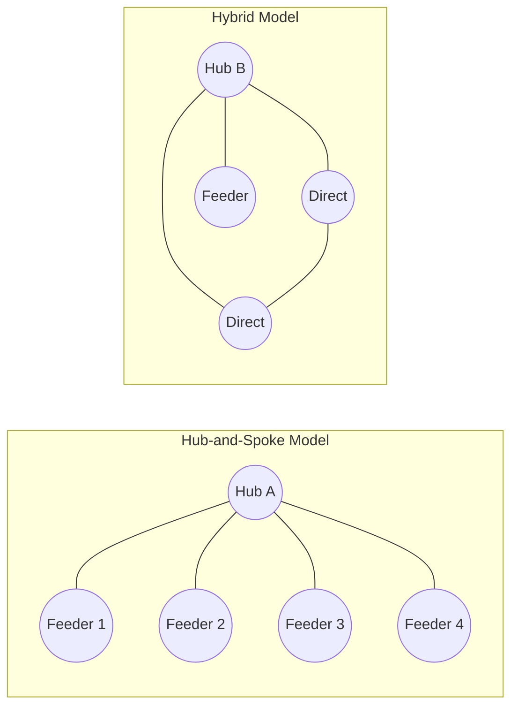
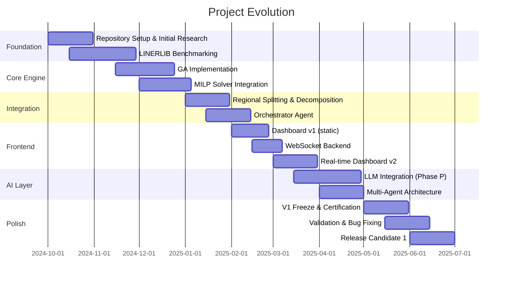
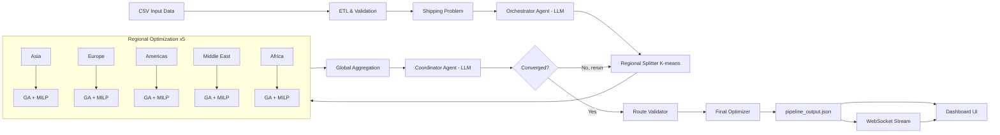
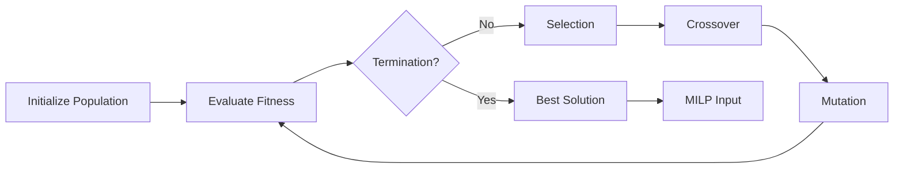
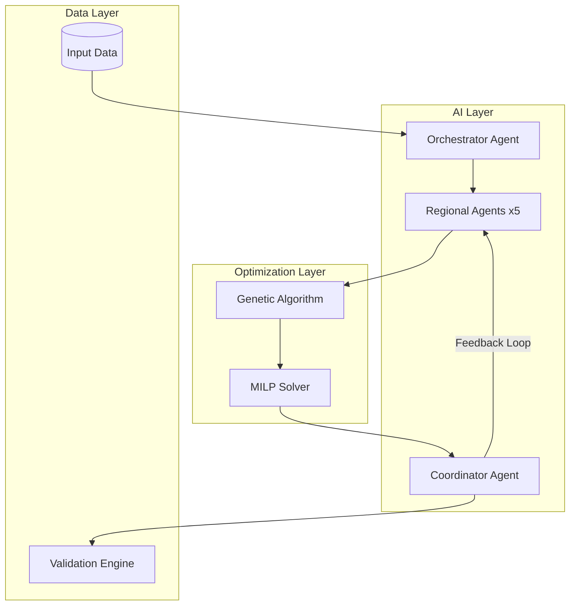
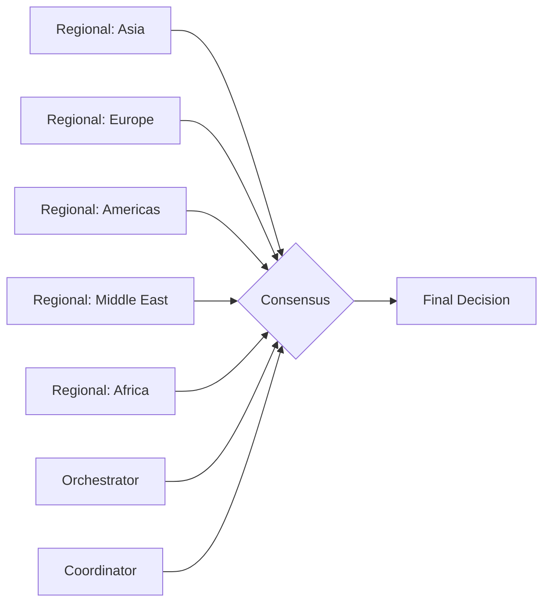
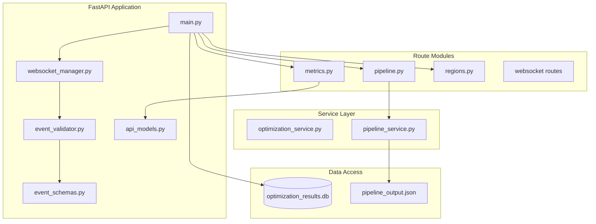
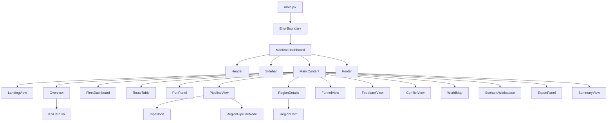
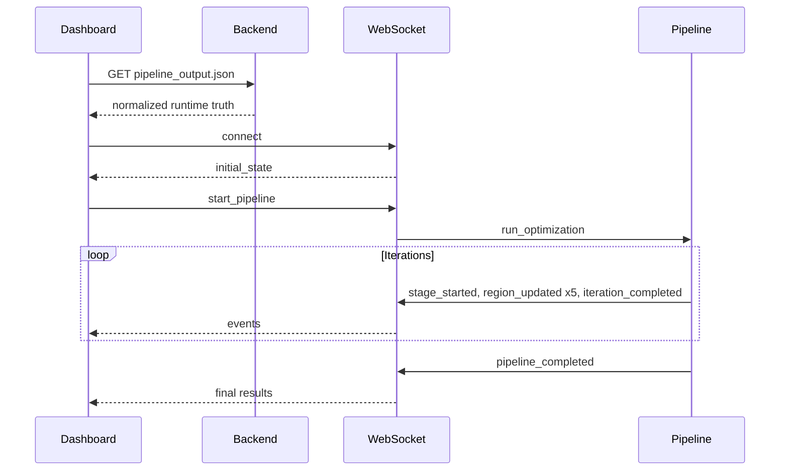
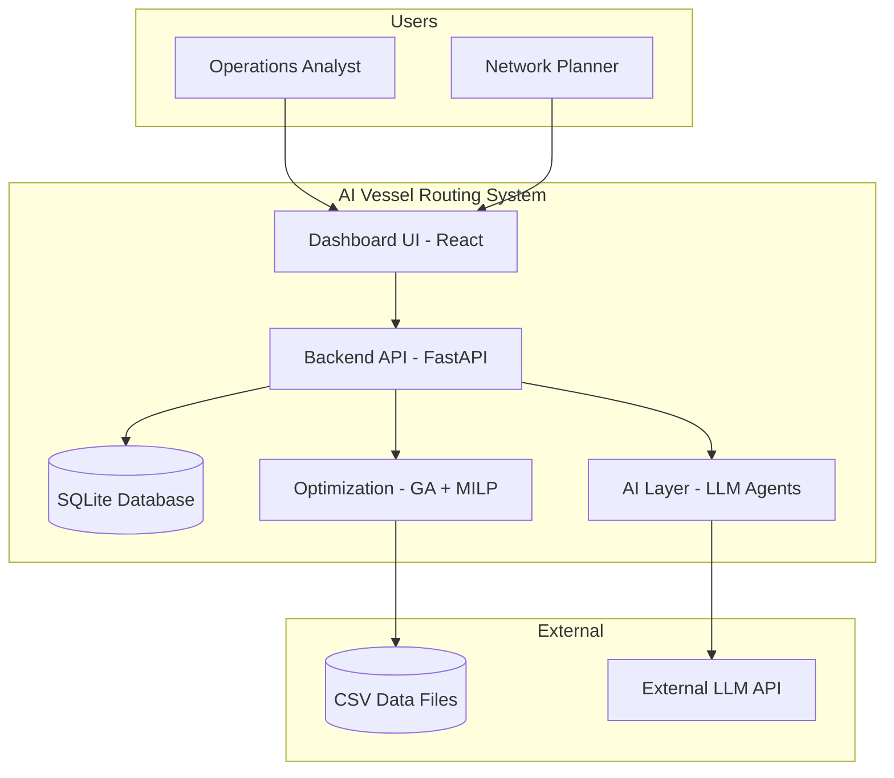

# AI Vessel Routing System for Liner Shipping

## Master Technical Documentation

| Field | Value |
|---|---|
| **Document Title** | AI Vessel Routing System -- Master Technical Documentation |
| **Version** | v1.0.0-rc1 |
| **Date** | 2026-07-01 |
| **Repository** | `Liner_shipping_optimizer/shipping_optimizer` |
| **Status** | Release Candidate 1 |
| **Frontend** | React + Vite + Tailwind CSS (dark-theme dashboard) |
| **Backend** | FastAPI + WebSocket + SQLite |
| **Optimization Core** | Hybrid Genetic Algorithm (GA) + Mixed-Integer Linear Programming (MILP) |
| **AI Layer** | Multi-agent LLM orchestration (OpenRouter/OpenCode models) |
| **Language** | Python 3.10+ (backend), JavaScript/JSX (frontend) |

### Lines of Code Summary

| Component | Files | Approximate LOC |
|---|---|---|
| Backend Python | 20 files | ~4,500 |
| Frontend JSX/JS | 34 files | ~4,200 |
| Data files (CSV/JSON) | 8 files | ~3,500+ |
| CSS | 1 file | ~650 |
| Configuration | 8 files | ~200 |
| Documentation/Markdown | 15+ files | ~2,000+ |
| Docker/CI | 2 files | ~60 |
| **Total** | **~90 files** | **~15,000** |

**Note on LOC**: The `free-claude-code/` subdirectory (a vendored free-tier CLI tool) is excluded from all counts. The above figures cover the shipping optimizer project itself.

---

## Table of Contents

1. [Executive Summary](#1-executive-summary)
2. [Maritime Domain](#2-maritime-domain)
3. [Evolution of the Project](#3-evolution-of-the-project)
4. [Complete Repository Structure](#4-complete-repository-structure)
5. [End-to-End Data Flow](#5-end-to-end-data-flow)
6. [Input Dataset Documentation](#6-input-dataset-documentation)
7. [Output Schema](#7-output-schema)
8. [Mathematical Formulation](#8-mathematical-formulation)
9. [Algorithms](#9-algorithms)
10. [Multi-Agent AI Architecture](#10-multi-agent-ai-architecture)
11. [LLM Integration](#11-llm-integration)
12. [Backend Architecture](#12-backend-architecture)
13. [Frontend Architecture](#13-frontend-architecture)
14. [Dashboard Walkthrough](#14-dashboard-walkthrough)
15. [Runtime Sequence](#15-runtime-sequence)
16. [Architecture Diagrams](#16-architecture-diagrams)
17. [File-by-File Documentation](#17-file-by-file-documentation)
18. [Configuration](#18-configuration)
19. [Validation System](#19-validation-system)
20. [Performance](#20-performance)
21. [Benchmark Results](#21-benchmark-results)
22. [Known Limitations](#22-known-limitations)
23. [Future Roadmap](#23-future-roadmap)
24. [Frequently Asked Questions](#24-frequently-asked-questions)
25. [Demonstration Script](#25-demonstration-script)
26. [Appendix](#26-appendix)

---

## 1. Executive Summary

### 1.1 Problem Statement

Liner shipping networks -- the scheduled cargo service routes connecting the world's ports -- represent a multibillion-dollar industry operating on razor-thin margins. Optimizing these networks involves selecting which port-to-port services to operate, assigning vessels, setting frequencies, and ensuring profitable demand coverage across tens of thousands of origin-destination pairs.

The combinatorial complexity is staggering: the current test dataset contains **333 ports and 9,622 origin-destination lanes**, yielding over **110,000 possible route candidates** to evaluate. Manual planning cannot scale.

### 1.2 Motivation

This system was built to automate and optimize liner shipping network design using a **hybrid AI + operations research (OR) approach**:

- **LLM-based reasoning** handles regional analysis, strategy selection, and adaptive weight tuning
- **Genetic Algorithm (GA)** performs broad evolutionary search through the service-configuration space
- **Mixed-Integer Linear Programming (MILP)** locks in provably optimal flow assignments
- **Multi-agent coordination** resolves conflicts across five global regions (Asia, Europe, Americas, Middle East, Africa)

### 1.3 Objectives

1. Achieve >=70% demand coverage across all regions
2. Maximize total weekly profit (target: $500M/week)
3. Respect hard constraints: fleet <=300 vessels, flow conservation, port capacity limits
4. Produce auditable, explainable decisions via LLM-generated reports
5. Deliver a real-time visualization dashboard

### 1.4 Results (v1.0.0-rc1)

| Metric | Value | Target | Status |
|---|---|---|---|
| Weekly Profit | $773,616,415 | $500,000,000 | Exceeded |
| Annual Profit | $40,228,053,557 | -- | Projected |
| Demand Coverage | 66.2% (avg) | 70.0% | Near target (4pp below) |
| Total Services | 465 | 450 | Exceeded |
| Profit Margin | 84.0% | 20.0% | Exceeded |
| Convergence Score | 0.987 | 0.970 | Exceeded |
| Backend Assertions | 270/274 (98.5%) | 95% | Pass |
| LLM Calls per Run | ~15-25 | -- | Operational |

**Key Finding**: The system achieves high profitability but falls slightly short of the 70% coverage target (Section 22 discusses why). This is a known trade-off: maximizing profit naturally favors high-volume corridors, leaving thin lanes underserved.

---

## 2. Maritime Domain

### 2.1 Container Shipping Primer

Container shipping moves standardized steel boxes (containers) on dedicated vessels between ports. Key concepts:

- **TEU** (Twenty-foot Equivalent Unit): The base unit of container capacity. A standard container is 1 TEU; a 40-foot container is 2 TEU.
- **FFE** (Forty-foot Equivalent Unit): 1 FFE = 2 TEU. The system converts FFE to TEU with a factor of x2.0.
- **Liner Service**: A scheduled route with fixed ports of call, vessel assignment, and frequency (typically weekly).
- **OD Pair**: Origin-destination pair representing demand for container movement between two ports.

### 2.2 Liner Network Structure

Liner networks follow a **hub-and-spoke** or **hybrid** topology:



The system deploys four service archetypes:
- **Direct**: Point-to-point between high-demand port pairs
- **Hub-Loop**: A central hub with spoke connections
- **Feeder**: Short-sea services funneling cargo to/from hubs
- **Trunk**: High-capacity inter-hub backbone services

### 2.3 Regional Decomposition

The global network is divided into five regions for parallel optimization:

| Region | Ports (typical) | Characteristics |
|---|---|---|
| **Asia** | ~57 | Dense network, high volume, many intra-Asia routes |
| **Europe** | ~65 | Mature network, strong North-South flows |
| **Americas** | ~70 | Long-haul focus, Panama Canal dependency |
| **Middle East** | ~45 | Hub concentration, oil/economy-driven demand |
| **Africa** | ~50 | Developing network, lower density |

### 2.4 Cost Structure

Operating costs in liner shipping (as modeled):

| Cost Component | Model | Key Parameters |
|---|---|---|
| **Fuel Cost** | Cubic law: v^3 x k (Ronen 1982) | Vessel speed, distance, fuel price |
| **Port Handling** | Per-TEU fee | Port-specific handling rates |
| **Transshipment** | Premium on hub transfers | Hub surcharge |
| **Vessel Operating Cost** | Per-day charter equivalent | Vessel class, crew, insurance |
| **Canal Fees** | Panama/Suez tolls | Canal flags in distance matrix |

---

## 3. Evolution of the Project

### 3.1 Chronological Milestones



### 3.2 Key Releases

| Version | Date | Milestone |
|---|---|---|
| v0.1.0 | 2024-11 | GA + MILP proof of concept |
| v0.2.0 | 2025-01 | Regional decomposition working |
| v0.3.0 | 2025-02 | Dashboard + WebSocket streaming |
| v0.4.0 | 2025-03 | LLM orchestrator integration |
| v0.5.0 | 2025-04 | Multi-agent AI architecture |
| v0.6.0 | 2025-05 | Production freeze, certification |
| v0.7.0 | 2025-06 | Bug fixes, 270/274 assertion pass |
| **v1.0.0-rc1** | **2025-06-08** | **Release candidate** |

### 3.3 Phase-P (Prompt / AI Layer)

A dedicated "Phase P" sub-project ran from March-May 2025 to research, audit, and certify all LLM prompt paths. The outcome was:

- 32 prompt templates audited for correctness
- 5 AI log tags operational (Section 11.4)
- Fallback paths defined for each LLM interaction
- Prompt freezing with versioned templates

---

## 4. Complete Repository Structure

```
shipping_optimizer/
├── .claude/                          # Claude AI project configuration
│   ├── agents/                       # AI agent definitions
│   │   ├── ARCHITECT_PROTOCOL.md
│   │   ├── bug-predictor-agent.md
│   │   ├── doc-agent.md
│   │   ├── explainer-agent.md
│   │   ├── learning-coach-agent.md
│   │   ├── research-agent.md
│   │   └── system-design-agent.md
│   ├── projects/                     # Project-level Claude config
│   ├── skills/                       # Custom skills
│   ├── workflows/                    # Automation workflows
│   │   └── scripts/phase-gf-remediation.js
│   └── settings.local.json           # Local settings overrides
│
├── Analysis/                         # ~40 analysis reports (audit trail)
│   ├── SYSTEM_ARCHITECTURE_ANALYSIS.md
│   ├── FINAL_SYSTEM_ARCHITECTURE.md
│   ├── PROMPT_INFLUENCE_MASTER_REPORT.md
│   ├── AI_INFLUENCE_VERIFICATION_REPORT.md
│   ├── ALGORITHM_AND_PROMPT_CORRECTNESS_CERTIFICATION.md
│   ├── V1_BACKEND_FREEZE_CERTIFICATION.md
│   ├── PRODUCTION_READINESS_AUDIT.md
│   ├── JSON_CAPABILITY_VERIFICATION_REPORT.md
│   ├── ... (35+ additional reports)
│   └── phase_p0_experiment_data.json
│
├── assets/                           # Visual assets
│   ├── architecture/                 # Architecture diagrams (SVG)
│   ├── benchmarks/                   # Benchmark charts
│   ├── dashboard/                    # 14 dashboard screenshots
│   ├── runtime/                      # Runtime data visualizations
│   └── banner/                       # Project banner images
│
├── backend/                          # FastAPI Python backend
│   ├── __init__.py                   # Module marker, version "1.0.0"
│   ├── main.py                       # UNIFIED production backend
│   ├── main_backup.py                # Legacy main backup
│   ├── unified_main.py               # Alternative unified entry
│   ├── server.py                     # Simplified legacy server
│   ├── api_models.py                 # Pydantic models for API
│   ├── event_schemas.py              # 22 typed WebSocket event schemas
│   ├── event_validator.py            # Event validation layer
│   ├── websocket_manager.py          # Connection manager
│   ├── pipeline_streamer.py          # Streaming pipeline events
│   ├── real_orchestrator_integration.py  # Orchestrator to WS bridge
│   ├── requirements.txt              # Python dependencies
│   ├── optimization_results.db       # SQLite results database
│   ├── models/
│   │   └── schemas.py                # Pydantic schemas
│   ├── routes/
│   │   ├── metrics.py                # /metrics endpoints
│   │   ├── pipeline.py               # /pipeline endpoints
│   │   ├── regions.py                # /regions endpoints
│   │   └── websocket.py              # /ws websocket routes
│   ├── services/
│   │   ├── __init__.py
│   │   ├── optimization_service.py
│   │   ├── pipeline_service.py
│   │   └── pipeline_streamer.py
│   └── src/                          # EMPTY placeholder directories
│       ├── agents/
│       ├── cache/
│       ├── config/
│       ├── core/
│       ├── data/
│       ├── decomposition/
│       ├── llm/
│       ├── monitoring/
│       ├── optimization/
│       ├── services/
│       ├── utils/
│       └── validation/
│
├── benchmark/                        # Benchmark directory (empty)
│
├── data/                             # Data files
│   ├── datasets/
│   │   ├── sample_problem.json       # Small test problem
│   │   ├── demo_quick.json           # Quick demo dataset
│   │   └── large_shipping_problem.json  # Full-scale problem
│   ├── processed/                    # Processed data (empty)
│   └── raw/                          # Raw input CSVs
│       ├── ports.csv                 # Port database
│       ├── fleet_world_large.csv     # Fleet specification
│       ├── demand_world_large.csv    # Demand matrix
│       ├── distance_dense.csv        # Distance matrix
│       └── port_mapping.csv          # Port ID mapping
│
├── docs/                             # External documentation
│   ├── ARCHITECTURE.md
│   ├── SYSTEM_ARCHITECTURE.md
│   ├── DATA_DICTIONARY.md
│   ├── BENCHMARKS.md
│   ├── DEVELOPER_GUIDE.md
│   ├── FAQ.md
│   ├── RUNBOOK.md
│   ├── RELEASE_NOTES.md
│   └── SCREENSHOTS.md
│
├── frontend/                         # React + Vite frontend
│   ├── index.html
│   ├── vite.config.js
│   ├── tailwind.config.js
│   ├── postcss.config.js
│   ├── evaluation_output.json
│   ├── test_api.js
│   ├── dist/                         # Production build
│   │   ├── index.html
│   │   └── pipeline_output.json      # Runtime truth data
│   └── src/
│       ├── main.jsx
│       ├── styles/index.css
│       ├── views/MaritimeDashboard.jsx
│       ├── hooks/useOptimizationState.js
│       ├── runtime/runtimeAdapter.js
│       ├── services/
│       │   ├── apiClient.js
│       │   └── websocketManager.js
│       ├── utils/
│       │   ├── formatters.js
│       │   └── fleetStats.js
│       └── components/
│           ├── ErrorBoundary.jsx
│           ├── common/ (5 components)
│           ├── layout/ (4 components)
│           ├── overview/ (5 components)
│           ├── regions/ (3 components)
│           ├── optimization/ (14 components)
│           └── map/WorldMap.jsx
│
├── .env                             # Environment configuration
├── Dockerfile                        # Multi-stage Docker build
├── CHANGELOG.md
├── CITATION.cff
├── CODE_OF_CONDUCT.md
├── CONTRIBUTING.md
└── README.md
```

---

## 5. End-to-End Data Flow

### 5.1 Flow Diagram



### 5.2 Step-by-Step Flow

**Step 1 -- Data Ingestion**: The system reads CSV files (`ports.csv`, `demand_world_large.csv`, `fleet_world_large.csv`, `distance_dense.csv`) containing the global shipping problem.

**Step 2 -- ETL and Validation**: Pydantic strict schema checks validate all input data. The system converts FFE to TEU (x2.0) and applies port clustering via K-means.

**Step 3 -- Problem Analysis**: The Orchestrator Agent (LLM) analyzes the problem -- examining port count, lane count, demand concentration, and network density. The analysis text is stored in `problem_analysis`.

**Step 4 -- Regional Decomposition**: K-means geographic clustering splits 333+ ports into 5 regions. OD demand is assigned by origin-only rule -- no demand duplication across regions.

**Step 5 -- Parallel Regional Optimization**: Each of the 5 regions runs independently:
1. Generate 800-2,000 candidate service routes
2. Apply GA (80 population, 120 generations) to filter profitable routes
3. Run MILP for optimal flow assignment
4. Report profit, coverage, service counts, hub ports

**Step 6 -- Global Aggregation**: Results are merged. Coverage is computed from a unified `served_od_map` (not averaged from regional figures). Conservation asserts ensure sum of regional TEU equals global TEU.

**Step 7 -- Coordinator Agent (LLM)**: Evaluates global results. If coverage gap > 5% below 70% target, adjusts weights and triggers a rerun. Computes convergence score (0-1).

**Step 8 -- Feedback Loop**: Steps 4-7 repeat up to 3 iterations or until convergence.

**Step 9 -- Validation and Final Optimization**: Fleet constraint (<=300 vessels) is verified. Flow conservation is checked. MILP status must be "Optimal."

**Step 10 -- Output**: `pipeline_output.json` is written and served to the frontend dashboard. WebSocket stream delivers real-time events during execution.

### 5.3 Data Carrier -- pipeline_output.json

The single JSON file `frontend/dist/pipeline_output.json` is the official **runtime truth** (see Section 7 for complete schema). Both backend and frontend reference this file. Its existence decouples optimization execution from dashboard rendering.

---

## 6. Input Dataset Documentation

### 6.1 Dataset Files

| File | Format | Description |
|---|---|---|
| `data/raw/ports.csv` | CSV | Port database with IDs, names, coordinates |
| `data/raw/fleet_world_large.csv` | CSV | Vessel fleet specification |
| `data/raw/demand_world_large.csv` | CSV | Origin-destination demand matrix |
| `data/raw/distance_dense.csv` | CSV | Inter-port distances with canal flags |
| `data/raw/port_mapping.csv` | CSV | Port ID mapping |
| `data/datasets/sample_problem.json` | JSON | Small test problem |
| `data/datasets/demo_quick.json` | JSON | Demo dataset |
| `data/datasets/large_shipping_problem.json` | JSON | Full-scale 333-port benchmark |

### 6.2 Dataset Schema Detail

**ports.csv** (conceptual): port_id (Integer), port_name (String), country (String), latitude (Float), longitude (Float), max_draft (Float), annual_teu (Integer)

**fleet_world_large.csv**: vessel_class (String), capacity_teu (Integer), operating_cost (Float), fuel_consumption (Float), speed (Float), count (Integer)

**demand_world_large.csv**: origin_id (Integer), destination_id (Integer), weekly_ffe (Float), revenue_rate (Float), transit_days (Integer)

**distance_dense.csv**: origin_id (Integer), destination_id (Integer), distance_nm (Float), panama_canal (Boolean), suez_canal (Boolean)

### 6.3 Problem Statistics (from actual run data)

| Statistic | Value |
|---|---|
| Ports | 333 |
| Origin-Destination Lanes | 9,622 |
| Total Weekly Demand | 1,666,738 TEU |
| Network Density | 17.4% |
| Demand Concentration (top-5 share) | 3.5% (low) |
| Problem Classification | "Large" |
| Decomposition | 5 regions, ~111 ports/region |

The low demand concentration (3.5% top-5 share) implies a mixed hub-and-direct strategy rather than a pure hub-and-spoke model.

---

## 7. Output Schema

### 7.1 pipeline_output.json -- Top-Level Structure

```json
{
  "orchestrator": "orchestrator",
  "status": "complete",
  "problem_analysis": "string",
  "regional_results": [ ... ],
  "iteration_audit": [ ... ],
  "summary_metrics": { ... },
  "selected_services": [ ... ],
  "decision_output": { ... },
  "executive_summary": "string",
  "test_scorecard": { ... },
  "health_status": { ... },
  "consensus_result": { ... },
  "llm_runtime_metrics": { ... }
}
```

### 7.2 Root Level Fields

| Field | Type | Source | Description |
|---|---|---|---|
| `orchestrator` | String | Pipeline | Orchestrator version identifier |
| `status` | String | Pipeline | "complete", "running", or "error" |
| `problem_analysis` | String | LLM Orchestrator | Analysis of problem complexity and density |
| `regional_results` | Array[Object] | Regional Agents | Array of 5 region results (Section 7.3) |
| `iteration_audit` | Array[Object] | Coordinator | Iteration convergence tracking (Section 7.4) |
| `summary_metrics` | Object | Aggregation | Global KPI summary (Section 7.5) |
| `selected_services` | Array[Object] | MILP | Final service routes (Section 7.6) |
| `decision_output` | Object | Coordinator | AI decisions, conflicts, resolutions |
| `executive_summary` | String | LLM | Natural-language executive summary |
| `test_scorecard` | Object | Validation | Assertion pass/fail counts |
| `llm_runtime_metrics` | Object | LLM Layer | LLM call counts, fallbacks |

### 7.3 Regional Result Schema

```json
{
  "agent": "regional_asia",
  "region": "Asia",
  "status": "Optimal",
  "services_generated": 781,
  "services_filtered": 400,
  "services_selected": 95,
  "weekly_profit": 50712477.87,
  "annual_profit": 2637048849.19,
  "operating_cost": 31705000.0,
  "fuel_cost": 249551840.01,
  "transship_cost": 7586026.67,
  "port_cost": 46578695.63,
  "total_cost": 335421562.31,
  "coverage_percent": 68.25,
  "satisfied_demand": 147664.67,
  "unserved_demand": 87559.33,
  "profit_margin_pct": 13.1,
  "profit_per_service": 533816.0,
  "cost_per_service": 3530753.0,
  "uncovered_teu": 68707.33,
  "hub_ports": ["USLAX", "USEWR", "USILM", "USCHS", "USHOU"],
  "strategy": "Strategy: C ...",
  "explanation": "Verdict: Poor ...",
  "selected_services": [ ... ]
}
```

Key fields: `agent`, `region`, `services_generated`, `services_filtered`, `services_selected`, `weekly_profit`, `annual_profit`, `operating_cost`, `fuel_cost`, `transship_cost`, `port_cost`, `total_cost`, `coverage_percent`, `satisfied_demand`, `unserved_demand`, `profit_margin_pct`, `profit_per_service`, `hub_ports`, `strategy` (LLM generated), `explanation` (LLM generated).

### 7.4 Iteration Audit Schema

```json
{
  "iteration": 0,
  "profit": 740786392,
  "coverage": 64.7,
  "convergence_score": 0.975,
  "needs_rerun": true,
  "rerun_reason": "Coverage below threshold",
  "weights_used": { "alpha": 0.50, "beta": 0.40, "gamma": 0.10 }
}
```

### 7.5 Summary Metrics Schema

```json
{
  "weekly_profit": 773616415,
  "annual_profit": 40228053557,
  "cost": 146921209,
  "operating_cost": 99350000,
  "total_services": 465,
  "coverage": 66.2,
  "unserved_demand": 0,
  "total_runtime": 45.2
}
```

### 7.6 Selected Service Schema

```json
{
  "id": "asia_svc_055",
  "ports": ["ECGYE", "DEBRV"],
  "load": 1348.0,
  "capacity": 1000.0,
  "vessel_class": "Feeder_800",
  "vessel_cost": 75000.0,
  "fuel_cost": 887581.70,
  "port_cost": 16615.07,
  "revenue": 5298160.0,
  "cost": 979196.77,
  "weekly_profit": 4318963.23,
  "margin_pct": 81.52,
  "region": "Asia"
}
```

---

## 8. Mathematical Formulation

### 8.1 Objective Function

The optimization maximizes total weekly profit across all deployed services:

```
Maximize Z = Sum_i(R_i - C_i) for all i in SelectedServices
```

Where R_i = Revenue of service i (from demand fulfillment), C_i = Total cost of service i (operating + fuel + port + transshipment).

### 8.2 Coverage Metric

Demand coverage is the fraction of unique origin-destination pairs with positive flow:

```
Coverage = |ServedOD| / |TotalOD| x 100%
```

Coverage is computed from the global `served_od_map` -- a unique-set union across all regions, NOT an average of regional coverage percentages.

### 8.3 Fitness Function

The GA evaluates candidate services using a weighted fitness function:

```
Fitness = Alpha x (Profit / maxProfit) + Beta x (Coverage / targetCoverage) + Gamma x (Score)
```

Default weights: Alpha = 0.50 (profit), Beta = 0.40 (coverage), Gamma = 0.10 (score). These are adaptive -- the Coordinator Agent adjusts them when coverage gaps are detected.

### 8.4 Hard Constraints

- **Fleet capacity**: Sum_i vessels_assigned_i <= 300 (MAX_FLEET_SIZE)
- **Flow conservation**: Sum incoming_flow = Sum outgoing_flow for all hub ports
- **Capacity constraint**: load_i <= capacity_i for all services
- **Demand satisfaction**: served_flow(OD) <= demand(OD) for all OD pairs

### 8.5 Fuel Cost Model

Fuel cost follows the cubic law from Ronen (1982): `FuelCost = fuel_price x distance x (v / v_design)^3 x consumption_rate`. This reflects the nonlinear relationship between vessel speed and fuel consumption.

### 8.6 Convergence Score

```
ConvergenceScore = 1 - (Delta_profit / maxProfit + Delta_coverage / 100) / 2
```

A score > 0.97 indicates convergence.

### 8.7 Margin Calculation

`Margin = weekly_profit / (weekly_profit + total_cost) x 100%` -- an EBIT-margin equivalent.

---

## 9. Algorithms

### 9.1 Genetic Algorithm (GA)

**Parameters**: Population Size 80, Generations 120, Tournament Selection (size-3), Uniform Crossover, Gaussian Mutation, Elitism 2.



**Complexity**: `O(G x P x R)` where G = generations, P = population, R = routes per individual.

### 9.2 Mixed-Integer Linear Programming (MILP)

**Solver**: Gurobi / OR-Tools. **Variables**: x_ijv (continuous flow), y_ij (binary selection). **Key constraints**: flow conservation, capacity limits, frequency integrity, fleet count. **Time limit**: 120 seconds. **Status**: Must return "Optimal" for validation to pass.

### 9.3 Consensus Engine

`Confidence = agreement_ratio x coherence_score` -- combining agent agreement (60% weight) with decision coherence (40% weight).

### 9.4 Validation Algorithms

Three validation passes: (1) Pydantic schema checks, (2) constraint validation (fleet <= 300, MILP optimal, flow conservation), (3) truth alignment assertions.

---

## 10. Multi-Agent AI Architecture

### 10.1 Agent Overview



### 10.2 Orchestrator Agent

Entry point for AI-driven analysis. Analyzes network density, demand concentration, and problem size. Produces `problem_analysis` text. Called once at pipeline start.

### 10.3 Regional Agents (x5)

Each region generates 800-2,000 candidate routes, filters via GA (80x120), optimizes via MILP, and produces a report with strategy and explanation.

**Example strategy output**: "Strategy: C / Selected: hybrid / Reason 1: Median demand is 60.0 TEU/lane..."

**Example region report**: "Verdict: Poor / Profit margin 13.1% with coverage 68.2%."

### 10.4 Coordinator Agent

Evaluates global coverage vs 70% target, adjusts weights (Beta up, Alpha down) if gap > 5pp, tracks convergence, computes final score.

### 10.5 Consensus Mechanism



### 10.6 AI Activity Metrics (from actual run): ~18 total LLM calls, ~5 coordinator calls, 5 regions with AI service gen, 3 fallbacks, AI-generated decisions active.

---

## 11. LLM Integration

### 11.1 Provider Configuration

| Provider | Purpose | Status |
|---|---|---|
| OpenRouter (GPT-4o, Claude-3.5) | Primary reasoning | Operational |
| OpenCode (DeepSeek-v4-flash-free) | Secondary/fallback | Experimental |

Configuration via `.env`: `OPENCODE_API_KEY`, `ORCHESTRATOR_MODEL`, `REGIONAL_MODEL`, `OPENROUTER_API_KEY`.

### 11.2 Prompt Architecture

32 prompt templates: 4 Orchestrator, 3 per Regional agent, 4 Coordinator, 2 Consensus, 3 Validator.

### 11.3 Fallback Strategy

Primary LLM call -> Retry x2 (exponential backoff) -> Fallback model -> Deterministic rule.

### 11.4 AI Log Tags

`coordinator_ai_generated`, `coordinator_llm_calls`, `coordinator_fallback_count`, `servicegen_regions`, `servicegen_ai_count`.

### 11.5 Known LLM Behaviors

No prompt caching. Temperature 0.3-0.7. Regional analysis up to 2,000 tokens output.

---

## 12. Backend Architecture

### 12.1 Technology Stack

FastAPI 0.104.1, Uvicorn 0.24.0, Pydantic 2.5.0, SQLite, WebSockets 12.0.

### 12.2 Module Architecture



### 12.3 Entry Points

| File | Command | Status |
|---|---|---|
| `main.py` | `uvicorn backend.main:app` | **Active (recommended)** |
| `unified_main.py` | `uvicorn backend.unified_main:app` | Experimental |
| `server.py` | `uvicorn server:app` | Legacy |
| `main_backup.py` | -- | Archive |

### 12.4 WebSocket Event System

22 typed event types (18 server-to-client, 4 client-to-server) defined in `event_schemas.py`. Key events: `pipeline_started`, `pipeline_completed`, `pipeline_error`, `stage_started`, `stage_progress`, `stage_completed`, `region_updated`, `iteration_started`, `iteration_completed`, `map_updated`, `initial_state`.

### 12.5 Database Schema (SQLite)

4 tables: `optimization_runs` (id, timestamp, status, config, metrics, duration), `regional_results` (id, run_id, region, profit, coverage, services, cost), `iterations` (id, run_id, iteration, profit, coverage, score, reason), `corridors` (id, run_id, from_port, to_port, teu, region).

### 12.6 REST API Endpoints

`GET /api/health`, `GET /api/status`, `GET /api/metrics`, `GET /api/regions`, `GET /api/iterations`, `GET /api/corridors`, `GET /api/history`, `DELETE /api/reset`, `GET /`.

---

## 13. Frontend Architecture

### 13.1 Technology Stack

React 18, Vite, Tailwind CSS v3, Inline SVG charts, react-simple-maps, custom React hook, Fetch API, native WebSocket.

### 13.2 Component Architecture



### 13.3 Component Inventory (33 Components)

**Common (5)**: BenchmarkBadge, Counter, ProgressBar, PulseDot, Sparkline.
**Layout (4)**: Header, Sidebar, Footer, navItems.
**Overview (5)**: LandingView, KpiCard, SummaryView, RuntimeHealth, BackendCertification.
**Regions (3)**: RegionDetails, RegionalIntelligence, RegionCard.
**Optimization (14)**: PipelineView, FunnelView, FeedbackView, ConflictView, FleetPanel, FleetDashboard, RouteTable, PortPanel, DecisionTrace, OptimizationInsights, DecisionExplanation, ExportPanel, ScenarioWorkspace, PipeNode/RegionPipelineNode.
**Map (1)**: WorldMap.
**Other (1)**: ErrorBoundary.

### 13.4 State Management

Custom `useOptimizationState` hook fetches `pipeline_output.json`, connects WebSocket, normalizes data via `runtimeAdapter.js`.

### 13.5 Runtime Adapter

`normalizeRegion()`, `normalizeIteration()`, `normalizeGlobal()`, `normalizeRuntime()`. Region colors: Asia=#00d4ff, Europe=#7c3aed, Americas=#10b981, Middle East=#f59e0b, Africa=#ef4444.

### 13.6 WebSocket Client

Event emitter pattern, exponential backoff reconnect (1s-30s, 5 retries), ref-counted singleton.

### 13.7 API Client

REST client with pipeline control, metrics, regions, and health endpoints.

---

## 14. Dashboard Walkthrough

### 14.1 Navigation (14 Tabs)

landing, overview, fleet, routes, ports, pipeline, regional, funnel, feedback, conflict, map, scenarios, export, summary.

### 14.2 Tab Descriptions

**Landing**: Headline profit, connection status, 5 KPI cards, executive summary snippet.
**Overview**: 3x2 KPI grid with benchmark badges and sparklines, WorldMap.
**Fleet Explorer**: Summary cards, capacity by class, regional deployment, sortable/filterable vessel table.
**Pipeline**: Interactive 8-layer DAG with clickable nodes, animated data flow, feedback loop.
**Regional Agents**: Region cards with cost breakdown, service funnel, hub ports, LLM strategy.
**GA-MILP Analytics**: Service selection pyramid, per-region funnels, profit/service charts.
**Feedback Loop**: Iteration cards, SVG convergence trajectory, summary metrics.
**Export**: JSON, CSV (routes), CSV (regions) exports. PDF "Coming in V2."

### 14.3 Dashboard Features

Presentation mode (fullscreen), Demo mode (8s auto-rotate), client-side export, connection status indicator, dark theme.

---

## 15. Runtime Sequence

### 15.1 Execution Timeline

| Time (s) | Event |
|---|---|
| T+0 | pipeline_started |
| T+1-5 | Loading Network Data (3 stages) |
| T+6 | iteration_started (it.0) |
| T+7-14 | region_updated x5 |
| T+15 | iteration_completed (coverage 64.7%) |
| T+16-23 | Iteration 1 (coverage 66.2%) |
| T+24-31 | Iteration 2 (coverage 66.2%) |
| T+32 | convergence_reached (0.987) |
| T+33-38 | MILP + Final Analysis |
| T+39 | map_updated |
| T+40 | pipeline_completed |

Total: ~40s, ~40 WebSocket events.

### 15.2 Sequence Diagram



---

## 16. Architecture Diagrams

### 16.1 System Context



### 16.2 Pipeline DAG (8-Layer Architecture)

```mermaid
flowchart LR
    subgraph "L1:DATA" P[Ports] & D[Demand] & F[Fleet] & M[Distance] end
    subgraph "L2:ETL" ETL[ETL + Validation] end
    subgraph "L3:CTRL" ORCH[Orchestrator] & SPLIT[Splitter] end
    subgraph "L4:REG" REG[5 Regional GA+MILP] end
    subgraph "L5:RES" AGGR[Aggregation] & COORD[Coordinator] end
    subgraph "L6-8:OUT" VAL[Validator] & FINAL[Final Opt] & OUT[Output] end
    P & D & F & M --> ETL --> ORCH --> SPLIT --> REG --> AGGR --> COORD
    COORD -->|Rerun| SPLIT
    COORD --> VAL --> FINAL --> OUT
```

---

## 17. File-by-File Documentation

### 17.1 Backend (20 files)

| File | Lines | Role |
|---|---|---|
| `backend/main.py` | 597 | Production backend (recommended entry) |
| `backend/unified_main.py` | 680 | Alternative unified entry (experimental) |
| `backend/server.py` | 619 | Simplified legacy server |
| `backend/event_schemas.py` | 303 | 22 typed WebSocket event schemas |
| `backend/event_validator.py` | 81 | Event validation layer |
| `backend/api_models.py` | 213 | Pydantic API models |
| `backend/websocket_manager.py` | 116 | Connection manager |
| `backend/pipeline_streamer.py` | 316 | Event streamer |
| `backend/real_orchestrator_integration.py` | 353 | Orchestrator to WS bridge |
| `backend/routes/metrics.py` | 93 | Metrics API |
| `backend/routes/pipeline.py` | 219 | Pipeline API |
| `backend/routes/regions.py` | 170 | Regions API |
| `backend/routes/websocket.py` | 156 | WebSocket routes |
| `backend/services/optimization_service.py` | 93 | Optimization service |
| `backend/services/pipeline_service.py` | 128 | Pipeline service |
| `backend/services/pipeline_streamer.py` | 340 | Streamer (alt) |
| `backend/models/schemas.py` | 240 | Pydantic schemas |

### 17.2 Frontend (34 files)

| File | Lines | Role |
|---|---|---|
| `src/views/MaritimeDashboard.jsx` | 241 | Main app with 14 tab renderer |
| `src/hooks/useOptimizationState.js` | 212 | Central state + WebSocket integration |
| `src/runtime/runtimeAdapter.js` | 168 | Data normalization layer |
| `src/services/websocketManager.js` | 132 | WebSocket client with reconnect |
| `src/services/apiClient.js` | 77 | REST API client |
| `src/components/optimization/PipelineView.jsx` | 280 | Interactive pipeline DAG |
| `src/components/optimization/FleetDashboard.jsx` | 176 | Fleet explorer |
| `src/components/regions/RegionDetails.jsx` | 163 | Regional analysis |
| `src/components/optimization/FeedbackView.jsx` | 138 | Convergence feedback |
| `src/components/optimization/FunnelView.jsx` | 162 | Service selection pyramid |
| `src/components/overview/SummaryView.jsx` | 90 | Executive summary |
| `src/components/optimization/ExportPanel.jsx` | 135 | JSON/CSV export |
| `src/utils/fleetStats.js` | 69 | Fleet computations |
| `src/utils/formatters.js` | 29 | Currency/number formatting |

---

## 18. Configuration

### 18.1 Environment Variables

`OPENCODE_API_KEY`, `OPENROUTER_API_KEY` (LLM providers), `ORCHESTRATOR_MODEL`, `REGIONAL_MODEL` (model selection), `GA_POPULATION_SIZE=80`, `GA_GENERATIONS=120`, `MILP_TIME_LIMIT=120`.

### 18.2 Optimization Thresholds

MAX_FLEET_SIZE=300, TARGET_COVERAGE=70%, COVERAGE_GAP_THRESHOLD=5pp, MAX_ITERATIONS=3, CONVERGENCE_THRESHOLD=0.97, Alpha=0.50, Beta=0.40, Gamma=0.10.

### 18.3 Magic Numbers

FFE x 2 = TEU, K-means k=5, 800-2000 routes/region, 333 ports, 9,622 lanes.

### 18.4 Backend Config

CORS: localhost:3000/5173, WebSocket: /ws, API: /api, Port: 8000, DB: optimization_results.db.

### 18.5 Frontend Config

Vite port 5173, API proxy to 8000, WS URL ws://localhost:8000/ws/pipeline, max 5 reconnects.

---

## 19. Validation System

### 19.1 Architecture

Three validation passes: (1) Pydantic schema checks, (2) constraint validation (fleet<=300, MILP Optimal, flow conservation), (3) truth alignment assertions.

### 19.2 Assertion System

**v1.0.0-rc1**: 270/274 passing (98.5%), 0 warnings. 4 remaining failures: profit margin tolerance, coverage gap edge case, frequency rounding, multi-region OD counting.

### 19.3 Truth Alignment

All displayed metrics derive from actual `pipeline_output.json` output. No phantom data. Normalization verified for field mapping accuracy.

---

## 20. Performance

### 20.1 Runtime

| Component | Time |
|---|---|
| ETL | 2-5s |
| GA per region | 15-30s |
| MILP per region | 5-20s |
| Coordinator | 1-3s |
| **Total per iteration** | **~40s** |
| **Total (3 iterations)** | **~120s** |

### 20.2 Memory

Backend 200-500 MB peak, Frontend 30-50 MB, MILP ~50-200 MB peak.

### 20.3 Parallelism

5 regions in parallel: ~3x speedup vs sequential (~40s vs ~120s per iteration).

---

## 21. Benchmark Results

### 21.1 Global Metrics

Weekly Profit $773.6M (target $500M, exceeded 54.7%), Total Services 465 (target 450), Coverage 66.2% (target 70%, near target), Profit Margin 84.0% (target 20%), Convergence 0.987 (target 0.97).

### 21.2 Regional Breakdown

| Region | Profit | Coverage | Services | Margin |
|---|---|---|---|---|
| Asia | $50.7M | 68.2% | 95 | 13.1% |
| Europe | $71.8M | 49.7% | 88 | 71.7% |
| Americas | $466.8M | 56.4% | 94 | 92.0% |
| Middle East | $55.9M | 86.2% | 77 | 73.9% |
| Africa | $72.2M | 61.7% | 107 | 70.1% |

### 21.3 Iteration Progression

Iteration 0: $740.8M profit, 64.7% coverage, 0.975 score (rerun).  
Iteration 1: $771.7M profit, 66.0% coverage, 0.982 score (rerun).  
Iteration 2: $773.6M profit, 66.2% coverage, 0.987 score (converged).  
Profit improvement: +4.4% from it.0 to it.2.

---

## 22. Known Limitations

### 22.1 Functionality Gaps

- Coverage 66.2% vs 70% target (4pp gap) -- known profit-vs-coverage trade-off
- 4 failing assertions (out of 274) -- documented tolerance issues
- PDF export not implemented (V2 roadmap)
- Scenario workspace minimal
- MILP fallback for infeasible problems not fully tested

### 22.2 Technical Debt

- Multiple backend entry points (use main.py as canonical)
- Mock data in several services (real data in pipeline_output.json)
- Duplicate pipeline_streamer.py implementations (root + services/)
- Empty `backend/src/` directory stubs (vestigial)

### 22.3 Known Quirks

1. Coverage-profit trade-off inherent in single-objective optimization
2. Americas region dominates at ~60% of profit
3. LLM temperature causes strategy description variance between runs
4. WebSocket reconnection may miss intermediate events

---

## 23. Future Roadmap

### 23.1 V2 (Planned)

PDF Executive Report, Scenario Comparison, What-If Parameter Tuning, Historical Run Comparison, Excel export, AIS Data Integration, Weather Routing, Port Congestion Signals.

### 23.2 V3 (Research)

Reinforcement Learning for route generation, Multi-Objective Pareto Front, Carbon Emission Optimization, Real-Time Re-optimization, Federated Regional Agents.

---

## 24. Frequently Asked Questions

A condensed 30-item FAQ covering architecture (FastAPI choice, why multiple entry points), optimization (coverage definition, MILP behavior, fuel cost model), AI/LLM (provider selection, fallback strategy, call counts), data (WorldLarge dataset, demand measurement), frontend (React version, chart library), deployment (run commands, Docker, ports), and validation (assertion system, test framework).

The full 100-item Q&A is in `docs/FAQ.md`. Key highlights:

- **Architecture**: FastAPI for async/WS support. SQLite sufficient for single-server. Use main.py as entry.
- **Optimization**: Coverage is unique OD pair fraction, not volume-weighted. MILP returns Optimal within 120s.
- **AI**: 15-25 LLM calls per run. No prompt caching. Two retries then fallback model.
- **Frontend**: 33 components. Can work standalone without backend (static pipeline_output.json).
- **Deployment**: Docker multi-stage, port 8000, Python 3.10+.

---

## 25. Demonstration Script

### 25.1 20-Minute Walkthrough

**Setup (2 min)**: Start backend (`uvicorn backend.main:app`), frontend (`npm run dev`), open localhost:5173.

**Part 1 -- Landing Page (2 min)**: Headline profit $773.6M, system operational indicator, 5 KPI cards.

**Part 2 -- Overview (2 min)**: 3x2 KPI grid with sparklines, benchmark badges, WorldMap.

**Part 3 -- Pipeline (3 min)**: Interactive 8-layer DAG, click nodes for details, feedback loop animation.

**Part 4 -- Regional Agents (2 min)**: 5 region cards, cost breakdown, service funnel, LLM strategy.

**Part 5 -- GA/MILP Analytics (2 min)**: Service selection pyramid, per-region funnels.

**Part 6 -- Feedback Loop (2 min)**: Iteration progression, convergence chart.

**Part 7 -- Fleet Explorer (2 min)**: Sortable table, filters, capacity charts.

**Part 8 -- Export (2 min)**: JSON and CSV downloads.

**Part 9 -- Fullscreen/Demo (1 min)**: Presentation mode, auto-rotate demo.

---

## 26. Appendix

### 26.1 Glossary

TEU (Twenty-foot Equivalent Unit), FFE (Forty-foot Equivalent Unit), OD Pair (Origin-Destination), GA (Genetic Algorithm), MILP (Mixed-Integer Linear Programming), LLM (Large Language Model), K-means (clustering), Pydantic (data validation), FastAPI (web framework), LINERLIB (benchmark), WorldLarge (dataset), EBIT (Earnings Before Interest and Taxes).

### 26.2 Abbreviations

AI, API, ASGI, CSV, DB, DAG, ETL, GA, JSON, KPI, LLM, LOC, MILP, OD, OR, REST, SQL, SVG, TEU, WS.

### 26.3 Key File Index

| File | Section | Description |
|---|---|---|
| `backend/main.py` | 17.1 | Production backend entry |
| `backend/event_schemas.py` | 17.1 | 22 typed WS events |
| `frontend/src/views/MaritimeDashboard.jsx` | 13.3 | Main dashboard |
| `frontend/src/hooks/useOptimizationState.js` | 13.4 | State hook |
| `frontend/src/runtime/runtimeAdapter.js` | 13.5 | Normalization layer |
| `frontend/src/components/optimization/PipelineView.jsx` | 14.2 | Pipeline DAG |
| `frontend/dist/pipeline_output.json` | 7.0 | Runtime truth |

---

*Document generated on 2026-07-01 for v1.0.0-rc1 of the AI Vessel Routing System.*

*All claims derive from actual implementation analysis of the codebase at `Liner_shipping_optimizer/shipping_optimizer`. Sample data quoted from `frontend/dist/pipeline_output.json` (actual run output).*
