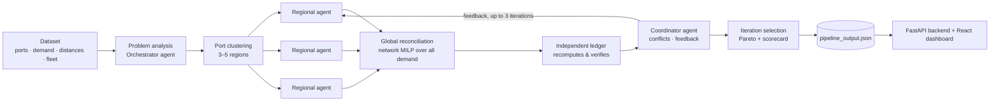

<div align="center">

# AI Vessel Routing — Liner Shipping Network Optimizer

**Multi-agent liner shipping network design: LLM-assisted agents + genetic algorithms + MILP,
with every reported number recomputed by an independent accounting ledger.**


</div>

---

## What it does

Given a liner shipping problem from the [LINERLIB](https://github.com/blof/LINERLIB)-style data
format (ports, origin–destination container demand, sea distances and a fleet of vessel classes),
the optimizer designs a **weekly service network** for a container shipping line:

- **which services (closed port rotations) to operate**, and how many departures per week each gets,
- **how many vessels of each class** to deploy on every service, within the real fleet inventory,
- **how each container flow (TEU/week) is routed**, including transshipment between services,
- and the resulting **weekly revenue, cost, profit, demand coverage and utilisation**.

The answer is written to a single `pipeline_output.json` and explored in an interactive dashboard.

## How it works



1. **Decomposition** — ports are clustered into 3 regions (5 for problems with 50+ ports); each
   demand is assigned to its origin's region (`src/decomposition/`).
2. **Regional agents** (run in parallel, `src/agents/regional_agent.py`) each:
   - generate candidate services with a feasibility screen (`src/services/`),
   - filter them by stand-alone economics under an adaptive budget,
   - search with a **hierarchical GA** — `ServiceGA` picks services, `FrequencyGA` picks weekly
     departures from real rotation times (`src/optimization/`),
   - allocate cargo with a region-level MILP (`HubMILP`).
3. **Global reconciliation** (`src/network/reconcile.py`) — regional results share vessels and
   services, so they are *not* additive. The union of all regional candidates is re-planned as
   **one network over all demand** by a path-based MILP (`src/network/network_milp.py`):
   integer frequencies and vessel counts, TEU flows per path, per-leg capacity, per-class fleet
   limits. It is followed by an LP flow re-optimisation over the full valid path set
   (`flow_reopt.py`) and an optional exact local search (`local_search.py`).
4. **Independent ledger** (`src/network/ledger.py`) — recomputes revenue, vessel, fuel, port-call,
   handling and transshipment costs straight from the raw data, without the model that produced
   the plan, and checks every constraint. Only a ledger-verified plan is reported as verified.
5. **Coordinator agent + feedback loop** — identifies conflicts between regions and produces
   feedback (weights, elite rotations) for the next iteration; the run stops when it converges or
   after 3 iterations.
6. **Iteration selection** (`src/pipeline/iteration_selection.py`) — every iteration is a
   candidate; the final plan is chosen by Pareto dominance and a multi-objective scorecard,
   never simply "the last iteration".

### Where the LLMs fit

LLMs (via [Groq](https://groq.com), OpenAI-compatible API) are **advisory**: problem analysis,
regional strategy hints, plain-language explanations, coordinator reasoning and iteration
selection under a strict JSON contract. They never set the economics — the MILP decides the plan
and the ledger decides the numbers. A provider router (`src/llm/providers/`) handles fallback
models (`qwen` → `gpt-oss-120b` → `gpt-oss-20b`), a circuit breaker for rate limits, and a
rule-based path when no LLM is available, so a run always completes.

## Datasets

| Dataset | Type | Ports | OD demand pairs |
|---|---|---:|---:|
| `baltic` | LINERLIB regional | 12 | 22 |
| `WAF` (West Africa) | LINERLIB regional | 20 | 37 |
| `WorldSmall` (default) | LINERLIB world | 47 | 1,764 |
| `World-500` | synthetic | 500 | 18,796 |
| `World-1000` | synthetic | 1,000 | 35,171 |

Each dataset lives in `data/raw/<name>/` and is compiled to a canonical JSON in `data/datasets/`
(registry: `src/data/dataset_registry.py`).

## Results — 30-seed benchmark

Mean over 30 seeds per dataset (`Benchmark/seed-30/`); every run's plan was ledger-verified with
zero accounting discrepancies.

| Dataset | Weekly profit | Profit margin | Demand coverage | Services | Mean runtime |
|---|---:|---:|---:|---:|---:|
| baltic | $0.63 M | 23.7 % | 60.2 % | 3.0 | 50 s |
| WAF | $5.05 M | 41.1 % | 79.7 % | 8.8 | 6 s |
| WorldSmall | $46.99 M | 32.5 % | 48.2 % | 30.1 | 412 s |
| World-500 | $172.04 M | 40.2 % | 15.1 % | 76.6 | 573 s |
| World-1000 | $246.58 M | 38.9 % | 12.9 % | 121.0 | 353 s |

Profit is the optimizer's weekly operating profit under each dataset's revenue and cost data —
a modelling result, not a forecast. Coverage stays well below 100 % because the optimizer is
profit-first: unprofitable demand is left unserved rather than carried at a loss.
One World-500 seed exited with a failed assertion (its plan was still verified).

## Dashboard

A React + Vite console (`frontend/`) served by a FastAPI backend (`backend/server.py`), organised in
8 groups:

| Group | Views |
|---|---|
| Overview | Command Center — KPIs, profit waterfall, service P&L |
| Network | Routes & services map, transshipment, transit finder, schedules, sea state |
| Demand & Ports | Demand served/unserved per lane, port activity |
| Fleet | Vessel deployment and utilisation per class |
| Optimization | Decision summary, pipeline stages, regional agents, GA/MILP convergence, feedback loop |
| Benchmarks | 30-seed results with confidence intervals, run-vs-run diff |
| Scenarios | Scenario analysis, what-if re-pricing of a plan, emissions & EU ETS, reliability |
| System | Health, maritime data sources, LLM telemetry |

A run picker switches between the latest run, the benchmark runs and extra runs.

## Quick start

**Requirements:** Python 3.11, Node.js 18+, a free [Groq API key](https://console.groq.com)
(optional — without one the pipeline uses its rule-based path).

```bash
cd Liner_shipping_optimizer/shipping_optimizer

# Python environment
python -m venv venv
venv\Scripts\activate            # macOS/Linux: source venv/bin/activate
pip install -r requirements.txt

# LLM configuration
copy .env.example .env           # macOS/Linux: cp .env.example .env  — then set GROQ_API_KEY

# Frontend
cd frontend && npm install && cd ..
```

### Run the optimizer

```bash
python tests/test_orchestrator.py                                # numbered dataset menu
python tests/test_orchestrator.py --dataset WorldSmall --non-interactive
python tests/test_orchestrator.py --dataset baltic --seed 7 --non-interactive
python tests/test_orchestrator.py --datasets all                 # every dataset, one after another
python tests/test_orchestrator.py --list                         # datasets and their paths
```

WorldSmall writes `pipeline_output.json` at the project root (and the dashboard's copy); other
datasets write to `reports/dataset_runs/<dataset>/`. `--output-dir` sends a run anywhere else.

### Open the dashboard

**Windows, one click:** `launch_dashboard.bat` finds the newest run, starts the backend on a free
port, starts the dashboard and opens the browser. Pass a run folder to show a specific run:
`launch_dashboard.bat runs_extra\worldsmall_seed00_20261024`.

**Manually (any OS):**

```bash
# terminal 1 — backend (from shipping_optimizer/)
python -m uvicorn backend.server:app --port 8000

# terminal 2 — dashboard
cd frontend && npm run dev       # http://localhost:5173
```

If port 8000 is reserved on Windows, run the backend on another port and start the dashboard with
the same value in `API_PORT` (e.g. `set API_PORT=8090`).

### Tests

```bash
python -m pytest tests --ignore=tests/test_orchestrator.py   # Python unit tests
cd frontend && node --test "tests/*.test.mjs"                # dashboard unit tests
```

`tests/test_orchestrator.py` is the full end-to-end pipeline run (minutes, LLM calls, rewrites
`pipeline_output.json`), so it is run on its own as shown above rather than inside the unit suite.

## Repository layout

```
Liner_shipping_optimizer/shipping_optimizer/
├── src/
│   ├── agents/          orchestrator, regional, coordinator and service-generator agents
│   ├── decomposition/   port clustering and regional problem splitting
│   ├── services/        candidate service generation and feasibility screening
│   ├── optimization/    ServiceGA, FrequencyGA, hierarchical GA, regional HubMILP
│   ├── network/         network MILP, flow re-optimisation, local search, ledger, economics
│   ├── pipeline/        iteration selection
│   ├── llm/             LLM client and provider router (fallback, circuit breaker)
│   ├── data/            dataset registry, loaders, canonical JSON
│   ├── benchmark/       paper-comparison evaluator
│   └── validation/      consensus engine and policy validators
├── backend/             FastAPI server: run catalog, what-if, maritime data routes
├── frontend/            React + Vite dashboard
├── maritime/            maritime data ingestion (AIS, weather, congestion) — feature-flagged
├── data/                raw datasets and canonical JSON
├── tests/               pipeline driver (test_orchestrator.py) and test suite
├── Benchmark/seed-30/   30-seed benchmark results
├── docs/                architecture, methodology, formulation, runbook
└── launch_dashboard.bat one-click dashboard launcher (Windows)
```

Further reading: [architecture](Liner_shipping_optimizer/shipping_optimizer/docs/ARCHITECTURE.md),
[cost / revenue / profit formulation](Liner_shipping_optimizer/shipping_optimizer/docs/COST_REVENUE_PROFIT_FORMULATION.md),
[methodology](Liner_shipping_optimizer/shipping_optimizer/docs/METHODOLOGY_FOR_PAPER.md),
[multi-dataset guide](Liner_shipping_optimizer/shipping_optimizer/docs/MULTI_DATASET.md),
[runbook](Liner_shipping_optimizer/shipping_optimizer/docs/RUNBOOK.md),
[data dictionary](Liner_shipping_optimizer/shipping_optimizer/docs/DATA_DICTIONARY.md).

## Authors

- **Nandeeshwar Vaddi**
- **Ajaykumar Mallameeda** ([@Ajaykumar-Mallameeda](https://github.com/Ajaykumar-Mallameeda))

## License

[MIT](Liner_shipping_optimizer/shipping_optimizer/LICENSE)
